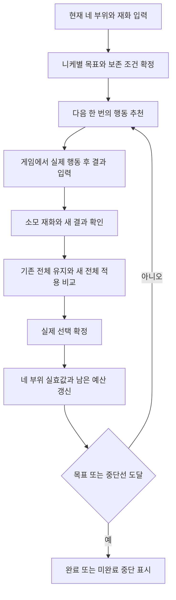

# 니케 오버로드 최소비용 운영 규칙 및 동적 경로 추천 서비스 명세

작성·검증 기준일: **2026-11-04, 한국시간**  
니케별 차지 속도 예외 규칙 보완: **2026-11-06, 한국시간**  
동일 단계 묶음별 반올림·실효값 계산 보완: **2026-11-06, 한국시간**  
상황별 경로 재계산 서비스 요구사항 보완: **2026-11-06, 한국시간**  
목표: **솔로레이드에 필요한 성능을 확보하면서 커스텀 모듈과 커스텀 락 키의 총소모를 줄이는 것**  
범위: 공통 규칙, 니케별 판단 기준, 현재 옵션에서 목표 옵션까지 매 시도 경로를 재계산하는 서비스의 동작 명세. 이 문서 자체에서는 개인 보유 옵션을 판정하지 않는다.

> 핵심 원칙: **실전 필수 조건을 먼저 충족하고, 네 부위의 합계로 목표를 정하며, 보존할 가치가 있는 줄만 잠근다. 옵션 종류와 수치의 완벽함은 별도 목표다.**

빠르게 찾기:

| 알고 싶은 내용 | 해당 절 |
|---|---|
| 현재 게임의 변경·잠금 규칙 | 3~4절 |
| 다음에 어느 부위를 돌릴지 | 5~9절 |
| 니케별 추천 옵션·차속 예외 | 6.5~6.10절 |
| 동일 단계 반올림·실제 차지 시간·증가 탄수 | 5.4~5.9절 |
| 락키와 영구 잠금의 비용 비교 | 10절 |
| 수치작 목표와 예상 소모 | 11~12절 |
| 새 결과를 적용할지 | 13~15절 |
| 예산·중단·계산기 사용 | 16~17절 |
| 실행 직전 확인과 기록 양식 | 18~20절 |
| 근거와 검증 한계 | 21절 |
| 서비스 입력·목표·운영 범위 | 22절 |
| 상태 전이·확률·최적화 계산 | 23절 |
| 결과 입력과 추천 갱신·화면 출력 | 24절 |
| 규칙 버전·불확실성·추천 재현 | 25절 |
| 구현 시 필수 검증 사례·완료 기준 | 26절 |

## 1. 이 문서를 읽는 기준

### 1.1 사실·계산·권고를 구분한다

- **[공식 확인]**: 공식 업데이트 원문으로 확인한 기능 변경이다.
- **[자료 교차 확인]**: 공개 공략·확률표·계산기에서 대조한 게임 규칙이다. 직접 게임 클라이언트의 확률 안내를 촬영해 검증한 것은 아니다.
- **[계산 모델]**: 확인한 확률·비용을 바탕으로 조건을 명시해 계산한 결과다. 실제 서버의 난수 구현을 입증한 수치는 아니다.
- **[운영 권고]**: 재화 절약을 위한 판단 기준이다. 공식 정답이나 모든 상태에서의 수학적 최적 정책을 뜻하지 않는다.

최신 시스템 변경의 기준은 **2026-09-17 장비 개조 개선 공지**다. 공식 사이트의 본문은 일반 웹 열람에서 비어 있었으나, 공식 사이트가 사용하는 공개 공지 API에서 해당 공지 본문을 직접 확인했다. 본문의 핵심 변경 사항을 한국어 공지 전재본과도 대조했다. [S1] · [S2]

2025년 공략은 기본 비용·잠금의 성격을 확인하는 데 사용하되, 잠금 재료가 언제 소모되는지와 중복 결과 처리는 2026년 공지를 우선한다. 8월 개발자 노트의 예정 설명보다 9월 실제 업데이트 공지의 세부 규칙을 우선한다.

### 1.2 최소비용의 의미부터 정한다

모듈 최소화와 락키 최소화는 항상 같은 선택이 아니다. 락키를 쓰면 영구 잠금에 필요한 초기 모듈을 아낄 수 있지만, 동일한 줄을 오래 보존하면 락키가 반복해서 소모된다.

따라서 기본 운영 목표는 다음 순서로 둔다.

1. 필요한 실전 성능을 얻는다.
2. 다른 니케의 필수 세팅에 쓸 모듈을 확보한다.
3. 오래 유지할 잠금에는 영구 잠금을, 잠시 유지할 잠금에는 락키를 검토한다.
4. 작은 수치 상승 때문에 두 재화를 계속 소모하는 작업을 중단한다.

**어느 재화에도 손해가 없는 선택이 있으면 그것을 우선한다. 둘 사이의 교환이 생기면 보유량·수급·작업 기간에 따라 결정한다.**

### 1.3 서비스를 구현할 때의 규칙 우선순위

이 문서는 사용자가 **현재 옵션·재화·목표를 입력하고, 매 시도 결과를 반영할 때마다 다음 행동을 갱신하는 서비스**의 기준으로 사용한다. 한 번 만든 고정 순서표를 끝까지 따라가는 방식으로 구현하지 않는다.

규칙 적용 순서는 다음과 같다.

1. 검증된 게임의 합법 행동·비용·확률과 선택한 반올림 모델.
2. 사용자가 확정한 목표, 보존 조건, 예산, 재화 우선순위.
3. 니케·형태·애장품·편성·실제 역할에 맞는 옵션 유효도와 실효값.
4. 현재 상태에서 가능한 행동들의 남은 비용·완료 확률 비교.
5. 계산량이 부족할 때 사용하는 공통 운영 요령.

3번 줄을 먼저 보존한다, 2유효면 중단한다, 종류를 먼저 맞추고 수치작을 한다 같은 문구는 **후보를 찾는 운영 요령**이다. 계산으로 더 나은 경로를 찾았는데도 강제하는 고정 규칙으로 사용하지 않는다. 사용자가 정한 필수 조건과 게임 규칙은 계산 편의를 위해 완화하지 않는다.

22~26절은 이 서비스의 **구현 요구사항**이며, 이미 해당 기능이 구현되었다는 의미가 아니다. 게임 규칙의 불확실성은 21절의 검증 범위와 함께 관리한다.

## 2. 용어와 기록 방법

| 표기 | 의미 | 기록할 내용 |
|---|---|---|
| 모듈 | 커스텀 모듈 | 최초 개조·영구 잠금·매회 재설정 비용 |
| 락키 | 커스텀 락 키 | 1회 잠금 비용 |
| 효과 변경 | 옵션 종류를 다시 추첨 | 잠기지 않은 줄의 존재·종류·수치가 변할 수 있음 |
| 수치 재설정 | 기존 옵션의 수치를 다시 추첨 | 종류·줄 위치는 유지, 잠기지 않은 수치가 변함 |
| 1·2·3번 줄 | 한 부위 안의 물리적 슬롯 위치 | 유효 옵션 개수와 혼동하지 않음 |
| Lv.1~Lv.15 | 옵션 수치의 단계 | Lv.15가 최대. 퍼센트와 함께 기록 |
| 우코 | 우월코드 대미지 증가 | 적용되는 적 상성을 확인 |
| 공증 | 공격력 증가 | 기본 공격력 수치와 구분 |
| 장탄 | 최대 장탄수 증가 | 줄 수보다 실제 합계·장전 횟수를 확인 |
| 차속·차댐 | 차지 속도·차지 대미지 | 해당 무기·스킬의 적용 여부 확인 |

**첫 번째 잠금은 1번 줄을 잠근다는 뜻이 아니다.** 현재 아무 줄도 잠기지 않은 상태에서 3번 줄을 잠가도 첫 번째 잠금이다. 비용은 물리적 줄 번호가 아니라 잠긴 줄 수에 따라 달라진다.

기록 예시: `머리 / 1번 공증 Lv.8 / 2번 빈칸 / 3번 우코 Lv.11 / 영구 잠금 없음`. 2줄 장비라고만 기록하면 작업 비용을 제대로 비교하기 어렵다.

## 3. 먼저 확정해야 하는 게임 규칙

### 3.1 최초 개조

**[자료 교차 확인]** 제조사가 맞는 기업 장비를 필요한 강화 단계까지 올린 뒤, 최초 오버로드 개조에 모듈 1개를 사용한다. 최초로 등장한 옵션의 수치는 **Lv.11 고정**이며, 이후 재설정부터 일반 수치 추첨을 적용한다. [S3] · [S4]

따라서 처음부터 중요한 옵션이 Lv.11로 붙었다면 그 자체로 가치가 있다. 흰색이라는 이유만으로 수치 재설정을 시작하면 낮아질 가능성이 크다. 최초 개조가 항상 3줄을 주는 것은 아니다.

### 3.2 효과 변경과 수치 재설정

| 작업 | 옵션 종류 | 수치 | 빈 2·3번 줄 | 잠긴 줄 |
|---|---|---|---|---|
| 효과 변경 | 다시 추첨 | 다시 추첨 | 생기거나 계속 비어 있을 수 있음 | 보존 |
| 수치 재설정 | 유지 | 다시 추첨 | 채워지지 않음 | 보존 |

효과 변경은 기존의 잠기지 않은 유효 옵션을 없앨 수 있다. 수치 재설정은 옵션 종류를 보존하지만, 여러 유효 줄의 수치가 함께 나빠질 수 있다. 결과는 기존 전체 상태를 유지하거나 새 전체 상태를 적용하며, **이전 결과의 한 줄과 새 결과의 다른 줄을 골라 합칠 수 없다**. [S4] · [S6]

결과를 거절해도 시도 비용은 돌아오지 않는다. 결과 유지 기능이 보존하는 것은 기존 옵션이며, 이미 사용한 재화가 아니다.

### 3.3 줄 위치별 등장 확률

**[자료 교차 확인]** 효과 변경 시 잠기지 않은 줄의 등장 확률은 다음과 같다. [S3]

| 물리적 위치 | 등장 확률 | 운영상 의미 |
|---|---:|---|
| 1번 줄 | 100% | 빈칸 위험이 없어 마지막에 남길 후보 |
| 2번 줄 | 50% | 옵션 종류 추첨 전에 빈칸 위험이 있음 |
| 3번 줄 | 30% | 효과 변경으로 좋은 옵션을 다시 얻기가 상대적으로 어려움 |

2·3번 줄의 등장 여부를 독립으로 취급하면, 무잠금 상태에서 등장하는 총 줄 수는 1줄 35%, 2줄 50%, 3줄 15%다. **3번 줄 등장 확률 30%와 총 3줄 확률 15%는 다른 수치다.**

줄의 존재 여부와 그 줄에 원하는 옵션이 붙을 확률도 다르다. 3번 줄이 떴다고 원하는 우코·공증을 얻은 것은 아니다.

### 3.4 같은 장비에는 같은 옵션이 중복되지 않는다

**[자료 교차 확인]** 한 부위에는 같은 옵션이 두 번 붙지 않는다. 서로 다른 부위에 붙은 같은 옵션은 합계로 관리한다. [S3] · [S7]

예를 들어 머리 한 부위에 공증 2줄을 만드는 목표는 불가능하다. 반면 머리·몸통·팔·다리에 공증을 각각 1줄씩 배치하는 목표는 가능하다.

옵션 종류는 중복 배제의 영향을 받는다. 따라서 잠금을 해도 남은 줄의 모든 옵션 확률이 완전히 같다고 일반화하지 않는다. **등장 확률, 옵션 종류 확률, 수치 단계 확률을 분리해서 판단한다.**

공개 확률표의 **옵션 종류 기본 가중치**는 다음과 같다. 합계는 100%다. 이 값은 빈칸 가능성과 현재 장비의 중복 배제를 모두 적용한 뒤의 최종 성공확률이 아니다. [S10]

| 기본 가중치 | 옵션 종류 |
|---:|---|
| 각 10% | 우월코드 대미지, 공격력, 크리티컬 대미지, 방어력 |
| 각 12% | 최대 장탄수, 명중률, 차지 대미지, 차지 속도, 크리티컬 확률 |

원하는 옵션 종류만 허용할 때와, 여러 대체 가능한 유효 옵션을 허용할 때는 성공확률이 다르다. 따라서 보조 줄에 명확한 필수 조건이 없다면, 특정 보조 옵션 하나만 고집하기보다 실제로 유효한 여러 옵션을 허용한다.

### 3.5 2026-09-17 중복 결과 방지의 정확한 의미

**[공식 확인]** 같은 슬롯에 이전과 **효과 및 수치가 모두 같은 결과**가 나오면 수치를 다시 추출한다. 효과 미획득, 즉 빈칸은 다시 나올 수 있다. [S1] · [S2]

다음은 보장되지 않는다.

- 이전과 같은 옵션 종류가 나오지 않는 것.
- 이전보다 높은 수치만 나오는 것.
- 빈 3번 줄이 다음 시도에는 반드시 채워지는 것.
- 한 번 나온 옵션 레벨가 이후 모든 시도에서 영구적으로 제외되는 것.
- 다른 줄에 과거와 같은 옵션·수치가 등장하지 않는 것.

예를 들어 공증 Lv.11을 수치 재설정하면 공증이라는 종류는 그대로다. 이전과 같은 Lv.11의 재등장을 막는 처리와, Lv.12 이상을 보장하는 처리는 전혀 다르다.

## 4. 비용표: 잠금 비용과 매회 비용을 분리한다

### 4.1 매회 효과 변경·수치 재설정 비용

**[자료 교차 확인]** 다음 비용은 영구 잠금·락키 잠금으로 보호하는 줄을 포함해 잠긴 줄 수로 계산한다. **락키를 쓴다고 잠금에 따른 매회 모듈 추가 비용이 사라지지 않는다.** [S5] · [S6] · [S7]

| 보호하는 줄 수 | 변경·재설정 1회 모듈 | 무잠금 대비 추가 모듈 |
|---|---:|---:|
| 0 | 1 | 0 |
| 1 | 2 | 1 |
| 2 | 3 | 2 |

잠금만 추가하고 실제 재설정을 하지 않으면 현재 개편 기준으로 재료가 소모되지 않는다. **재료 선택이 무료인 것이며, 잠금을 이용한 재설정이 무료인 것은 아니다.** [S1]

위 표는 최소 한 줄을 변경할 수 있는 0~2줄 보호 상태를 다룬다. 모든 줄을 보호하고 재설정하는 방식은 개선 대상이 없으므로 작업 경로로 사용하지 않는다.

### 4.2 새 잠금을 만드는 비용

| 새로 보호하는 단계 | 영구 잠금용 모듈 | 같은 단계의 1회 잠금용 락키 |
|---|---:|---:|
| 무잠금 → 1줄 잠금 | 2 | 20 |
| 1줄 잠금 → 2줄 잠금 | 추가 3 | 추가 30 |
| 두 줄을 모두 새로 잠금 | 합계 5 | 합계 50 |

영구 잠금은 해제하기 전까지 유지된다. 락키는 한 번의 변경·재설정만 보호하므로 계속 보호하려면 다음 시도에도 비용이 필요하다. 이전 잠금 설정 불러오기는 조작 편의 기능이며, 락키를 영구 잠금으로 바꾸거나 소모를 면제하는 기능이 아니다. [S1] · [S5] · [S7]

영구 잠금을 해제해도 이미 사용한 비용은 환급되지 않는다. 다시 영구 잠금을 만들면 당시 잠금 상태에 맞는 비용을 다시 계산한다. 실제 실행 직전에는 화면에 표시되는 **이번 시도의 모듈·락키 합계**를 확인한다.

### 4.3 일정한 잠금 상태로 N회 돌릴 때의 총비용

다음 표는 시작 시 영구 잠금이 없고, 중간에 잠금 수를 바꾸지 않으며, 반드시 N회 시도한다고 가정한다. 결과가 일찍 완성되면 실제 시도 횟수는 줄어든다.

| 방식 | 총 모듈 | 총 락키 |
|---|---:|---:|
| 무잠금 N회 | N | 0 |
| 1줄 영구 잠금 후 N회 | 2 + 2N | 0 |
| 1줄 락키 잠금으로 N회 | 2N | 20N |
| 2줄 영구 잠금 후 N회 | 5 + 3N | 0 |
| 2줄 락키 잠금으로 N회 | 3N | 50N |

**[계산]** 예를 들어 한 줄을 보호하고 10회 시도하면, 영구 잠금은 모듈 22개, 락키 잠금은 모듈 20개와 락키 200개다. 두 줄을 보호하고 10회 시도하면, 영구 잠금은 모듈 35개, 락키 잠금은 모듈 30개와 락키 500개다.

이 비용 비교는 **같은 보호·시도 계획** 안에서만 유효하다. 잠금 없이 돌릴 때는 성공확률과 보존 조건이 달라지므로, 모듈 N개라는 비용만 보고 무잠금이 항상 낫다고 판단할 수 없다.

## 5. 작업 전에 목표를 네 부위 합계로 작성한다

### 5.1 목표를 세 단계로 나눈다

**[운영 권고]** 이상적인 최종 옵션표를 곧바로 이번 작업의 완료 조건으로 사용하지 않는다.

| 단계 | 완료 조건 | 재화 사용 원칙 |
|---|---|---|
| 필수 작동 | 버스트·장전·스택·타수 등 편성의 기능이 성립 | 가장 먼저 예산 배정 |
| 실전 충분 | 현재 보스에서 충분한 딜과 안정성 확보 | 모듈 대비 팀 총딜 상승을 비교 |
| 장기 완성 | 추가 유효 줄, 고수치, 색상 완성 | 다른 필수 작업이 끝난 뒤 별도 예산 |

솔로레이드 상위 3%라는 목표가 모든 장비에 3유효·Lv.15를 요구한다는 근거는 없다. 반대로 몇 줄만 확보하면 반드시 상위 3%라는 보장도 없다. **총 5개 팀의 실제 합산 피해량을 기준으로 중단 여부를 정한다.**

### 5.2 옵션 개수와 합계 수치를 따로 정한다

아래처럼 기록한다. 숫자는 설명용이며 특정 니케의 권장값이 아니다.

```text
콘텐츠: 이번 솔로레이드 보스
편성·버스트 순서·큐브·소장품: 먼저 고정
필수 조건: 특정 구간에서 장전하지 않기
장탄: 네 부위 OL 합계 X% 이상
차속: 적용 버프를 포함해 필요한 임계치 이상
화력: 우코 최소 A줄, 공증 최소 B줄 또는 합계 목표
허용: 장탄은 어느 부위에 붙어도 됨
보존 조건: 현재 충족한 장탄 임계치는 깨지지 않음
이번 중단선: 필수 조건 + 화력 1단계 확보
제외: 모든 줄 Lv.15, 부위별 동일한 옵션 순서
```

4개의 장탄 옵션이 필요한 것이 아니라 일정 장탄 합계가 필요한 상황이라면, **2개의 높은 장탄과 3개의 중간 장탄 중 더 싸게 달성할 수 있는 쪽을 비교**한다. 줄 수를 줄이면 다른 유효 옵션을 넣을 공간이 생기지만, 높은 수치를 강제하는 비용도 발생한다.

우코·공증을 모든 부위에 각각 1개씩 확보하는 최종 목표와, 우선 몇 줄만 추가하는 중간 목표도 분리한다. 특정 부위에 이미 좋은 장탄·차속이 있다면 다른 부위에서 화력 옵션을 보충하는 경로를 먼저 검토한다.

### 5.3 부위별 고정 배치를 피한다

장탄은 반드시 머리, 차속은 반드시 팔이라는 식의 배치를 강제하지 않는다. 이미 나온 옵션을 활용해 전체 목표의 배치를 바꾸면 재화가 절약될 수 있다.

예외는 부위별로 한 번씩 필요한 옵션이다. 예를 들어 우코 4줄을 목표로 하면 같은 부위에 중복할 수 없으므로 결국 네 부위 모두에 필요하다. 이 경우에도 **어느 물리적 줄에 우코를 넣을지는 고정할 필요가 없다.**

### 5.4 차속·장탄은 표시 합계와 실효값을 분리한다

**동일 옵션·동일 단계는 먼저 묶어 합산하고, 서로 다른 단계의 묶음은 각각 반올림한 결과를 더한다.** 같은 단계의 옵션이 몇 개 있는지까지 기록한다. 표시된 소수 퍼센트를 모두 더한 값만으로 실제 차지 시간·장탄수·완료 여부를 판정하지 않는다.

사용자가 제시한 묶음별 계산 원칙을 반영했으며, 차속의 동일 수치 합산·반올림은 공개 가이드와 계산기 개발자의 변경 기록에서도 대조했다. 장탄도 같은 단계 묶음을 적용하는 실제 측정 사례가 있다. 다만 **반올림 대상의 단위는 구분**해야 한다. 차속을 정수 %로 설명하는 요약과, 기준 시간에 곱한 뒤 시간 단위로 반올림하는 정밀 모델을 혼동하지 않는다. 장탄의 실제 결과는 증가하는 정수 발수다. [S25] · [S26] · [S27] · [S28]

이 절은 공개 검증·계산 모델에 근거하며 공식 패치 공지로 확인한 규칙과는 구분한다. 스킬·큐브·소장품까지 OL과 하나의 묶음으로 합산한다고 확대 적용하지 않는다.

### 5.5 사용자 제시 차속 정수 % 모델과 예시

양수의 일반 반올림을 `R(x) = floor(x + 0.5)`로 정의한다. 옵션 단계 t의 표시 수치를 `p(t)`, 그 단계의 개수를 `n(t)`로 쓰면:

```text
묶음별 차속 요약값(%) = Σ R[n(t) × p(t)]

순서:
1. 차속 옵션만 모은다.
2. 동일 단계끼리 묶는다.
3. 각 묶음 안에서는 반올림하지 않고 먼저 합산한다.
4. 묶음별로 정수 반올림한다.
5. 다른 단계 묶음의 결과와 더한다.
```

**사용자 제시 예시의 계산:**

| 조합 | 묶음별 계산 | 결과 |
|---|---|---:|
| Lv.15 + Lv.14 + Lv.14 + Lv.13 | R(6.09) + R(5.80×2) + R(5.51) = 6+12+6 | **24%** |
| Lv.15×4 | R(6.09×4) = R(24.36) | **24%** |

첫 조합의 표시 합계는 23.20%지만 묶음별 정수 % 결과는 24%다. 표시 합계를 마지막에 한 번만 반올림해 23%로 계산하면 다른 결과가 된다.

이 정수 % 모델은 **기준 차지 시간 1초에 대해 감소 시간을 0.01초 단위로 계산하는 모델과 대응**한다. 다른 기준 시간의 니케까지 무조건 정수 %로 계산하는 것과는 구분하며, 정밀 시간 비교에는 5.7절을 사용한다. [S28]

### 5.6 장탄은 기본 장탄수에 곱한 증가 발수를 반올림한다

**[공개 검증·계산 모델]** 기본 장탄수 A, 장탄 옵션의 동일 단계 묶음 n(t), 표시 퍼센트 p(t)에 대해, OL만의 기여를 비교하는 식은 다음과 같다. [S27] · [S28]

```text
OL 증가 탄수 = Σ R[A × n(t) × p(t) / 100]
OL만 반영한 장탄수 = A + OL 증가 탄수
```

반올림하는 것은 장탄 증가율 자체가 아니라 **기본 장탄수에 해당 비율을 곱한 추가 발수**다. 다른 버프·무기 변환·소장품 효과는 그 적용 방식을 별도로 확인한다.

기본 장탄 6발, 다른 장탄 효과가 없는 예시:

| 장탄 조합 | 묶음별 증가 발수 | 최종 장탄 |
|---|---|---:|
| Lv.12 한 줄: 73.04% | R(6×0.7304) = 4 | 10발 |
| Lv.12 두 줄 | R(6×0.7304×2) = 9 | **15발** |
| Lv.9 두 줄: 각각 60.71% | R(6×0.6071×2) = 7 | **13발** |
| Lv.9 + Lv.10: 60.71%·64.82% | R(6×0.6071) + R(6×0.6482) = 4+4 | **14발** |

Lv.12 한 줄이 4발을 늘린다고 두 줄도 반드시 8발을 늘리는 것은 아니다. Lv.9 두 줄과 Lv.9+Lv.10의 차이도 단순 장탄% 합계만으로 판단하지 않는다. 기본 장탄수가 다르면 같은 옵션 조합도 결과가 달라진다.

### 5.7 차속의 정밀 시간 모델은 기준 차지 시간을 사용한다

공개 계산기는 같은 단계 묶음의 퍼센트를 **기준 차지 시간에 곱한 감소 시간**으로 바꾼 뒤 0.01초 단위로 반올림한다. 정수 % 설명만으로 모든 무기의 실제 시간을 확정하지 않도록 이 모델을 별도로 기록한다. [S28]

```text
R2(x) = 양수를 소수 둘째 자리까지 일반 반올림
C = 해당 공격에 적용되는 기준 차지 시간(초)

OL 감소 시간 = Σ R2[C × n(t) × p(t) / 100]
OL만 반영한 차지 시간 = C - OL 감소 시간
```

예를 들어 기준 1초에서 Lv.13 한 줄 5.51%는 0.0551초를 0.06초로 반올림하므로 6%에 대응한다. 기준 1.5초에서는 0.08265초를 0.08초로 반올림하므로, 감소 시간의 기준 시간 대비 비율은 약 5.33%다. 같은 줄이라도 기준 시간에 따른 실효값을 구분한다.

위 식은 **OL 기여를 비교하는 시간 모델**이다. 외부 차속 버프, 시전자 기준 버프, 무기 변환, 고정 시간, 발사·엄폐 지연, 프레임 처리까지 모두 포함한 최종 공격 주기 식으로 사용하지 않는다. 실제 임계치는 필요한 구간의 공격 횟수로 대조한다.

### 5.8 같은 실효값이면 더 높은 단계를 강제하지 않는다

**[운영 권고]** 목표는 높은 표시 수치가 아니라 실제 필요한 효과다.

1. 사용자 예시의 두 조합은 정수 % 모델에서 모두 24%다. 해당 조건의 차속만을 위해 전부 Lv.15로 바꾸지 않는다.
2. 현재 단계 구성을 바꾸면 동일 단계 묶음도 달라진다. 새 수치가 더 높아도 전체 실효값을 다시 계산한다.
3. 같은 실효값을 만족하는 여러 단계 조합을 허용하고 남은 예상 비용을 비교한다. 낮은 단계의 색상 때문에 다시 돌리지 않는다.
4. 특정 목표를 만족하는 단계 집합이 연속 구간이라는 보장은 없다. 단순히 T몇 이상을 전 줄에 강제하지 않는다.
5. 장탄은 최종 발수, 차속은 실제 감소 시간·추가 공격 횟수가 그대로라면 우선 중단 후보로 둔다.
6. 다른 유효 옵션까지 바뀌면 전체 결과를 비교한다. 차속만 같다는 이유로 모든 전투 결과가 같다고 보장하지 않는다.

**표시 수치 상승이 실효값 하락이 되는 예시:**

| 차속 조합 | 표시 합계 | 정수 % 묶음별 계산 |
|---|---:|---:|
| Lv.5×4 | 12.64% | R(3.16×4) = **13%** |
| Lv.5×3 + Lv.6 | 12.93% | R(3.16×3) + R(3.45) = 9+3 = **12%** |

같은 단계 네 줄 중 하나만 Lv.5→Lv.6으로 올리면 표시 합계는 오르지만 이 모델의 실효값은 떨어진다. 기준 1초 시간 모델에서도 감소 시간이 0.13초에서 0.12초로 줄어든다. 수치가 올랐으니 무조건 적용한다는 판단을 사용하지 않는다.

### 5.9 단계별 차속 정수 % 빠른 표

**같은 단계만 n줄인 묶음의 값**이며, 혼합 조합은 단계별 열 값을 각각 골라 더한다. 기준 1초 시간 모델에 대응하는 요약표다. 다른 기준 시간은 5.7절로 별도 계산한다.

| 단계 | 표시 수치 | 같은 단계 1줄 | 같은 단계 2줄 | 같은 단계 3줄 | 같은 단계 4줄 |
|---|---:|---:|---:|---:|---:|
| Lv.1 | 1.98% | 2% | 4% | 6% | 8% |
| Lv.2 | 2.28% | 2% | 5% | 7% | 9% |
| Lv.3 | 2.57% | 3% | 5% | 8% | 10% |
| Lv.4 | 2.86% | 3% | 6% | 9% | 11% |
| Lv.5 | 3.16% | 3% | 6% | 9% | 13% |
| Lv.6 | 3.45% | 3% | 7% | 10% | 14% |
| Lv.7 | 3.75% | 4% | 8% | 11% | 15% |
| Lv.8 | 4.04% | 4% | 8% | 12% | 16% |
| Lv.9 | 4.33% | 4% | 9% | 13% | 17% |
| Lv.10 | 4.63% | 5% | 9% | 14% | 19% |
| Lv.11 | 4.92% | 5% | 10% | 15% | 20% |
| Lv.12 | 5.21% | 5% | 10% | 16% | 21% |
| Lv.13 | 5.51% | 6% | 11% | 17% | 22% |
| Lv.14 | 5.80% | 6% | 12% | 17% | 23% |
| Lv.15 | 6.09% | 6% | 12% | 18% | 24% |

이 표의 표기 수치는 공개 단계표를 사용했고, 묶음별 결과는 위의 반올림 식으로 계산했다. 모든 값은 차속 옵션에 한정한다. 다른 옵션을 같은 방식으로 반올림하지 않는다. [S4] · [S10]

## 6. 어떤 옵션부터 필요한지 판정하는 규칙

### 6.1 우선순위는 기능 → 실전 화력 → 추가 수치다

| 우선순위 | 판정 기준 | 예시 |
|---|---|---|
| 1 | 없으면 편성 기능이 깨짐 | 필요한 장탄, 적용되는 차속 임계치, 해로운 장탄 제거 |
| 2 | 해당 보스에서 큰 화력 기여 | 상성 적용 우코, 주력 피해에 적용되는 공증 |
| 3 | 이미 있는 옵션의 낮은 합계 보완 | 임계치에 모자란 장탄 수치 |
| 4 | 상황별 보조 화력 | 크확·크댐·명중·차댐 중 실제 유효한 것 |
| 5 | 작은 고점 상승·색상 완성 | Lv.10을 Lv.12 이상으로, 이미 충분한 옵션의 Lv.15 추구 |

이 표는 모든 니케에게 우코가 공증보다 항상 높다는 뜻이 아니다. 적 상성, 자가 공격력 버프, 피해 종류, 팀 버프, 무기·스킬 구조에 따라 순서가 바뀐다.

### 6.2 장탄은 줄 수보다 전투 결과로 판정한다

- 실제 사용할 큐브와 큐브 레벨을 먼저 고정한다.
- 재장전 속도 버프·탄환 충전·버스트 시 장탄 충전 여부를 확인한다.
- 소장품·애장품과 스킬 레벨의 영향을 반영한다.
- 보스가 사라지는 구간, 자동 버스트 지연, 수동 조작도 고려한다.
- 필요한 구간에서 장전 횟수가 줄어들었으면 추가 장탄의 우선순위를 다시 낮춘다.
- 마지막 탄환 발동형 스킬처럼 장탄 증가가 불리할 수 있는 경우를 별도로 확인한다.

편성 변화만으로 필요한 장탄 줄 수가 바뀔 수 있다. 예를 들어 마리안: 퀸의 공개 분석도 큐브·재장전 지원·소장품 조건에 따라 필요한 장탄을 다르게 제시한다. 이 문서에서는 특정 조건의 장탄 목표를 모든 니케에 적용하지 않는다. [S8]

**마리안: 퀸의 기본 최종 후보는 우코4·공증4를 중심으로 장탄1~2줄의 필요 발수를 충족하고, 남은 칸의 크확·크댐을 비교하는 방식이다.** 공개 가이드에 장탄3줄 대안도 있으므로 1~2줄이 모든 조건의 절대 최적이라고 단정하지 않는다. 그러나 모듈 비용이 싸다는 이유만으로 장탄3줄을 최종 딜 세팅에 자동 채택하지 않는다. [S8]

장탄의 작동 조건은 **본인 버스트 구간 재장전 방지, 비버스트 구간 재장전 감소, 풀버스트 밖의 버스트 수급 지연 방지, 전투 전체 무장전**으로 나누어 저장한다. 본인 버스트 구간의 조건을 이미 충족했다면, 나머지 조건이 실제 목표인지 확인하기 전 추가 장탄 단계·줄을 필수로 승격하지 않는다. 사용자 편성이 확인되지 않은 가이드의 장탄 임계값은 조건부 비교 후보로 표시한다.

### 6.3 차속·차댐은 실제 적용을 확인한다

차지 무기를 든다는 이유만으로 두 옵션을 모두 필수로 지정하지 않는다. 버스트 중 무기 변환, 고정 차지 시간, 스킬의 별도 계수, 아군에게 전달하는 효과 등 예외를 확인한다.

차속이 임계치에 도달하면 추가 차속이 같은 수준의 효율을 유지한다고 가정하지 않는다. 수동 조작·프레임·버프 가동률의 영향까지 포함해 실제 공격 횟수와 버스트 회전으로 확인한다.

**차속이 높은 효율을 내는 니케에게는 차속을 핵심 화력 옵션으로 분류한다.** 우코·공증을 먼저 완성한 뒤 남는 줄에만 차속을 넣는 순서를 모든 니케에 적용하지 않는다. 구체적인 예외는 아래 6.5~6.10절을 우선한다.

### 6.4 지원형의 공증은 버프의 기준 능력치를 확인한다

스킬이 참조하는 것이 기본 공격력인지, 전투 중 최종 공격력인지부터 구분한다. 장비 강화로 증가하는 기본 능력치와 OL 공증 옵션을 같은 것으로 취급하면 재화를 잘못 쓸 수 있다.

예를 들어 브리드: 사일런트 트랙의 지원 버프는 기본 공격력 기반이며, 공개 분석은 장비·큐브·소장품 레벨을 강조한다. 지원만 목적인 경우와 본인 딜까지 요구하는 경우의 옵션 투자도 구분한다. **지원 성능을 올린다는 이유만으로 모든 지원형에게 공증 4줄을 요구하지 않는다.** [S9]

### 6.5 니케별 기준을 먼저 정하고 공통 비용 규칙을 적용한다

**[운영 권고]** 작업 순서는 **니케·형태·애장품·운용 확인 → 필수 옵션과 합계 결정 → 유효 줄 분류 → 잠금·재설정 비용 비교**다. 공통 규칙만으로 유효 옵션을 정하지 않는다.

| 니케별 필수 기재 항목 | 반드시 확인할 내용 |
|---|---|
| 정확한 대상 | 일반형·파생형·애장품 단계 구분 |
| 콘텐츠·역할 | 솔로레이드 주력 딜러, 비버스트 지원, PvP 수급 등 |
| 적용 구간 | 평상시, 본인 버스트, 동료 버스트, 특정 모드 |
| 필수 옵션·수치 | 줄 수와 OL 합계, 외부 버프 포함 합계, 작동 조건 |
| 권장 화력 옵션 | 우코·공증·차속 등의 상대 순서와 조건 |
| 유지 가능한 보조 | 굳이 재화를 쓰며 교체하지 않아도 되는 옵션 |
| 무효·불리 옵션 | 실제로 적용되지 않거나 운용에 불리한 옵션 |
| 편성 의존 | 차속 버프의 수혜자, 큐브, 장탄·재장전 지원 |
| 중단선·근거 | 실전 충분 기준과 장기 목표, 확인 날짜·출처 |

**우코4·공증4는 일부 딜러의 장기 목표 예시이며 모든 딜러의 선행 필수 조건이 아니다.** 차속 핵심 니케의 좋은 차속 줄을 보조나 무효로 오분류하면 교체 비용과 복구 비용을 모두 낭비할 수 있다.

### 6.6 차속을 네 종류로 분류한다

| 분류 | 작동 방식 | 최소비용 운영 |
|---|---|---|
| 임계치 달성형 | 특정 차속 합계에 도달하는 것이 중요 | 부족한 합계를 채운 뒤 과투자를 중단 |
| 지속 화력형 | 풀차지 횟수와 추가 피해 발동이 중요 | 차속을 핵심 유효로 인정하고 장탄·실제 발수와 함께 비교 |
| 조건부 지원·구간형 | 버스트 수급, 회복, 비버스트 구간 등에 기여 | 해당 구간의 팀 이득을 확인한 만큼 투자 |
| 고정 시간·비적용형 | 시간이 고정되거나 해당 무기가 차속을 사용하지 않음 | 차속을 목표에 넣지 않고 새 잠금 비용도 쓰지 않음 |

한 니케가 구간에 따라 여러 분류에 속할 수 있다. 버스트 공격만 고정 시간인 경우 평상시 차속까지 무효라고 판단하지 않는다. 반대로 SR로 변환한다고 반드시 차속이 적용되는 것도 아니다.

### 6.7 니케별 차속 예외표

**검증일: 2026-11-06.** 아래는 차속 판단에서 먼저 확인할 대표 사례다. 전체 니케의 완성 세팅 목록이나 투자 순위가 아니며, 표시한 줄 수는 **장기 배치 후보**다. 실제 필수 합계와 중간 중단선은 편성별로 정한다.

| 니케·형태 | 차속의 위치 | 권장 옵션의 기준·보존 규칙 | 핵심 조건·근거 |
|---|---|---|---|
| **네온: 비전 아이** | **핵심 화력** | 우코 중심으로 차속·공증을 비교. 공개 장기 예시는 우코4·차속4·공증2~3·장탄1~2 | 풀차지와 추가 피해가 연결됨. 장탄을 확보하고 실제 발수·장전을 확인. 공증4를 강제하며 좋은 차속을 버리지 않음. [S11] |
| **앨리스 일반형** | **임계치 핵심** | 필요한 실제 차지·발수 조건을 확보한 뒤 우코·공증·장탄 | S1·버스트 Lv.10 기준 **8.18%**는 반올림을 생략한 표시 수치의 잔여분. OL 단계 묶음·스킬·외부 지원을 반영하기 전에는 완료 판정값으로 사용하지 않음. [S12] · [S25] · [S28] |
| **홍련: 흑영** | **발수 임계치** | 우코·공증·필요 장탄과 차속을 함께 인정 | 공개 가이드의 단일 차속 **5% 초과**는 표시 수치의 참고값. 기준 차지 시간·단계 묶음·외부 지원을 반영한 실제 발수로 확인하며 차속4를 강제하지 않음. [S13] · [S28] |
| **리버렐리오** | **보스 모드 화력** | 우코·공증·필요 장탄 이후 유력한 보조 화력 | 스킬 차속 면역과 **OL 차속 적용을 구분**. 보스 모드에서는 본인에게 적용, 일반 적 대상 고정 시간 모드에서는 비적용. [S14] |
| **길티: 마이티 바니** | **풀차지 추가 피해에 유효** | 우코·공증·필요 장탄 중심으로 차속을 좋은 추가 화력으로 인정 | 버스트 한 발은 1.5초 고정이지만 평상시 추가 피해에는 유효. 자료별 추천 강도가 달라 네온처럼 무조건 차속4로 통일하지 않음. [S15] · [S16] |
| **신: 스위프트 바니** | **평상시·지원 구간 한정** | 우코·공증·장탄 중심으로 모드별 크리티컬·차댐과 비교 | 버스트 변환 5초간 차지 0.5초 고정. 길티와 같은 바니라는 이유로 같은 차속 효율을 적용하지 않음. [S17] |
| **헬름 애장품** | **수급·PvP 조건부** | PvE 개인 화력은 우코·공증 중심. 차속은 회전·PvP 수급을 보고 보존 | 풀차지의 회복·버스트 수급 활용. PvP 차속4 경로를 솔로레이드 필수로 옮기지 않음. [S18] |
| **레드 후드 일반형** | **비버스트·초과 전환** | 우코·공증·장탄과 풀차지/수동 운용 비교. 차속은 유효한 추가 경로 | 100% 초과 차속을 차댐으로 전환. 100% 초과라서 무효로 판정하지 않음. 라피: 레드 후드와 구분. [S19] |
| **아인** | **유지 가능한 보조** | 우코·공증·필요 장탄 중심으로 기존 차속을 보조 유효로 평가 | 차속을 무효 처리하지 않되 모든 차속을 핵심 필수로 올려 잠그지도 않음. [S20] |
| **브레디** | **조건부 보조** | 우코·공증·장탄 이후 차속·크확·크댐을 편성별 비교 | 차속은 유효 후보지만 모든 보조 줄을 차속으로 바꾸는 작업은 별도 이득 확인 필요. [S21] |
| **트리나** | **PvP 수급 중심** | PvP 차속4 경로와 PvE 장탄·지원 운용을 구분 | 지원형 차속 유효 사례. 솔로레이드만 목표라면 PvP 권장표만 보고 차속4를 의무화하지 않음. [S22] |
| **스노우 화이트: 헤비 암즈** | **비적용** | 우코·공증·필요 장탄 및 유효 보조 | 평상시 1.2초·특수 공격 3.2초 고정. OL 차속으로 단축되지 않아 목표·보호 대상에서 제외. [S23] |
| **신데렐라: 크리스탈 웨이브** | **비적용** | 우코·공증·장탄 중심 | MG와 차지 1초 고정 SR 모드 모두 차속 투자 대상이 아님. 신데렐라 일반형과 구분. [S24] |

자료의 이상적인 줄 수는 재화를 무제한으로 써야 하는 명령이 아니다. 차속의 딜 기여는 편성·장전·실제 공격 간격에 따라 달라지므로, 모든 니케에게 차속 한 줄은 딜 몇 %라는 공통 점수를 사용하지 않는다.

### 6.8 특히 잘못 판단하기 쉬운 세 사례

**앨리스: 두 줄이라는 모양보다 필요한 합계를 본다.**

S1·버스트 10의 표시 수치만 빼면 `100 - 80.15 - 11.67 = 8.18%`다. 그러나 이 값은 반올림을 생략한 산술 잔여분이며, 실제 OL 완료 임계치로 곧바로 사용할 수 없다. 공개 가이드의 99% 초과 실전 기준 역시 표시 합계·실제 차지 시간·수동 발수를 구분해 해석한다. [S12]

기존 예시 Lv.8 4.04% + Lv.9 4.33%의 **표시 합계는 8.37%지만, 서로 다른 단계의 정수 % 묶음 결과는 4+4=8%**다. 기준 1.5초의 OL 시간 모델에서도 감소 시간은 `R2(1.5×0.0404) + R2(1.5×0.0433) = 0.06+0.06 = 0.12초`다. 8.37%라는 숫자만 8.18%와 비교해 충족을 확정한 기존 설명은 철회한다. [S28]

다만 이것만으로 그 조합이 실전에서 부족하다고 단정하지도 않는다. 스킬·외부 버프의 적용과 반올림, 실제 연사 조건까지 함께 확인해야 한다. 최종 목표는 색상이나 특정 소수 합계가 아니라 해당 운용의 풀차지 발수·장전·회전이다.

**네온: 비전 아이: 차속을 공증 다음의 남는 옵션으로 고정하지 않는다.**

풀차지 추가 피해 구조이므로 차속은 본인 화력을 늘리는 주력 옵션이다. 공개 분석은 공증과 차속을 비슷한 중요도로 비교하고 리버렐리오와 함께할 때 차속 가치가 커질 수 있다고 설명한다. 공증4부터 완성하려고 좋은 차속을 지우는 작업은 재검토한다. 더 빠른 사격으로 장전이 늘 수 있으므로 발수·장전·팀 총딜을 함께 확인한다. [S11]

**리버렐리오: 면역 문구만 보고 OL 차속을 버리지 않는다.**

외부 차속 버프·디버프 면역과 OL 차속은 적용이 다르다. 보스 대상 모드에서는 OL 차속이 본인 사격 속도에 기여하고, 일반 적 대상 1초 고정 모드에서는 기여하지 않는다. 차속을 아군 지원을 위한 옵션으로만 설명하는 것도 부정확하다. 아군에게 주는 차속은 별도 S1 효과이며, 실제 수혜자와 그 니케의 공격 횟수도 따로 확인한다. [S14]

### 6.9 차속 유효 니케의 잠금·교체·중단 규칙

**[운영 권고]** 위 분류를 8~14절의 공통 판단에 먼저 반영한다.

1. **핵심 차속은 유효 줄에 포함한다.** 우코+공증+차속은 해당 니케에서 3유효가 될 수 있다.
2. **필요 합계를 충족하는 조합부터 보존한다.** 두 중간 수치로 목표를 넘으면, 한 줄 Lv.15로 압축하는 비용과 빈 슬롯의 이득을 별도로 비교한다.
   - 여기서 합계는 표시 합계가 아니라 5.4~5.9절의 묶음별 반올림을 반영한 실효값이다. 한 줄의 단계가 바뀌면 나머지 줄과의 묶음도 다시 계산한다.
3. **필수 합계가 깨지는 수치작을 계획 없이 시작하지 않는다.** 다른 옵션을 올리는 동안 차속이 낮아질 위험과 보호 비용을 반영한다.
4. **핵심 차속도 자동 영구 잠금하지 않는다.** 현재 수치가 완료값인지, 추가 수치작이 필요한지 정한 뒤 잠금 방식을 고른다.
5. **차속을 교체할 때 실제 손실을 확인한다.** 유효 줄 수가 같아도 공격 횟수 임계치가 깨지면 악화일 수 있다.
6. **외부 지원이 바뀌면 재계산한다.** 대상 판정·지속시간·버프가 없는 사이클을 포함한다.
7. **고정·비고정 구간을 분리한다.** 버스트가 고정이라는 이유로 평상시 차속까지 무효 처리하지 않는다.
8. **실제 추가 공격이 없으면 다음 임계치 비용을 비교한다.** 작은 수치 증가가 발수 증가를 보장하지 않는다.
9. **자동·수동·PvP 목표를 분리한다.** PvP용 차속을 PvE 무효로 지우거나, PvP 세팅을 솔로레이드 필수로 강제하지 않는다.
10. **정보가 부족하면 교체를 보류한다.** 확인되지 않은 고정 임계치를 만들어 좋은 차속을 지우거나 새 잠금을 하지 않는다.

### 6.10 니케별 옵션 기준 작성 양식

실제 옵션 평가 전에 아래 기준을 먼저 작성한다. 개인 보유 옵션 판정은 이 문서의 범위에 포함하지 않는다.

```text
[니케별 옵션 기준]
정확한 이름 / 일반형·파생형 / 애장품 단계:
콘텐츠 / 역할 / 자동·수동:
관련 스킬 레벨 / 편성 / 큐브:
차속 적용 구간: 평상시 / 본인 버스트 / 동료 버스트 / 모드
차속 분류: 임계치 / 지속 화력 / 조건부 지원 / 비적용
외부 차속의 수혜자 / 지속시간 / 없는 사이클:
필요 OL 차속 합계 / 계산 전제:
동일 단계별 개수 / 표시 합계 / 묶음별 반올림 결과:
기준 차지 시간 / OL 감소 시간 / 다른 버프 적용 확인:
판정 기준: 추가 풀차지 횟수 / 장전 횟수 / 팀 총딜
필수 / 주력 화력 / 보조 / 비적용 옵션:
이번 완료 기준 / 장기 목표:
기존 차속을 교체할 수 있는 조건:
크리 적용 공격 / 구간별 자기·외부 크확·크댐 / 수혜 조건:
크확 상한 도달 구간 / 크리로 발동하는 탄환·추가타 / 허용할 크확·크댐 조합:
출처 / 확인 날짜 / 미확인 조건:
```

### 6.11 크확·크댐은 편성에서의 다음 한 줄 가치로 비교한다

**[계산 모델]** 치명타가 적용되는 공격의 기본 크확은 15%, 기본 크리티컬 추가 대미지는 50%로 둔다. 한 공격 종류·버프 구간의 기대 피해는 `B × (M + p × d)`다. `B`에는 공격 횟수와 별도 배율을 넣고, `M`에는 해당 공격의 비크리 보정, `p`에는 0~100%로 제한한 유효 크확, `d`에는 기본값과 버프를 합친 크리 추가 배율을 넣는다. 소수 단위·상한은 내부 계산에서 유지하고 표시할 때 반올림한다. [피해 실측](https://ore-game.com/nikke/post/verify-memo/) · [크확 상한 및 가산 검증](https://note.com/tt00771/n/ne2803e70fd08)

1. 공격 종류와 버스트 구간별로 유효 크확과 크댐을 적용한다. 예를 들어 헬름†의 크확은 일반 공격, 미란다†의 큰 크확은 조건에 맞는 첫 발, 신살의 자기 버스트 크확은 일반 공격을 따로 본다. [편성별 크리티컬 계산과 스킬 근거](./니케별_오버로드_종결옵션_권장옵션_2026-11-07.md#편성별-크리티컬-계산)
2. 후보는 기존 장비를 포함한 상태 전체에서 비교한다. 크확·크댐의 상호작용 때문에 각 줄을 한 번씩 고르는 방식으로 2~3줄 목표를 만들면 다른 배분의 우위를 놓칠 수 있다. 현재 높은 줄을 유지하는 배분과 낮은 수치로도 동등한 배분을 함께 비교한다.
3. 다음 한 줄의 효과는 해당 편성 전체의 예상 점수 차이로 표시한다. 크리 때문에 탄환 회복·추가타·버프 발동 횟수가 바뀌거나 공증 때문에 버프 수혜자가 바뀌면 사격·장전·발동 순서를 다시 계산한다. 발동 또는 공격별 적용 여부가 미확인이라면 조건별 범위를 보여 주고 한 종류를 고정 종결로 잠그지 않는다.
4. **평균 점수와 리트라이 고점은 따로 평가한다.** 핵심 한 발의 크리 성공을 반복해서 노리는 운용은, 사용자가 목표로 선택했고 실제 판정 단위와 성공 확률을 확인한 경우에만 별도 목표로 표시한다.

## 7. 어느 부위부터 돌릴지 결정하는 규칙

### 7.1 다음 후보의 순서

**[운영 권고]** 우선 아래 조건을 순서대로 확인한다.

1. 이번 편성에서 필수 조건을 직접 해결할 수 있는 부위인가.
2. 이미 완성된 다른 부위에 손대지 않고 부족한 옵션을 얻을 수 있는가.
3. 보호할 가치가 큰 옵션이 적어 무잠금 또는 1줄 잠금으로 작업할 수 있는가.
4. 원하는 옵션을 찾을 슬롯이 1번 줄인가, 2·3번 줄인가.
5. 성공 시 네 부위 합계가 실제 완료 조건에 가까워지는가.

기본 후보는 유효 옵션이 적은 부위다. 다만 낮은 유효 개수만으로 결정하지 않는다. 한 줄뿐이어도 반드시 보존할 높은 장탄이 있으면, 다른 부위가 더 싸게 개선될 수 있다.

### 7.2 두 줄을 잠그고 빈 3번 줄을 찾는 경로는 우선 보류한다

이 경로는 매회 모듈 3개를 내면서 3번 줄의 빈칸 위험을 감수한다. 락키로 두 줄을 보존하면 매회 락키 50개도 추가된다.

따라서 먼저 다른 부위의 무잠금·1줄 잠금 경로, 목표 수치를 다른 줄에서 충족하는 경로, 현재 2유효로 중단하는 경로를 비교한다. 다른 모든 후보가 더 나쁘고 해당 세 번째 줄의 실전 가치가 클 때만 선택한다.

### 7.3 장비 강화 우선순위와 옵션 재설정 우선순위는 다르다

머리의 기본 공격력 강화가 효율적이라는 사실이 머리 옵션부터 재설정해야 한다는 뜻은 아니다. 이미 머리가 완성되었고 다리의 옵션이 부족하다면, 옵션 재설정 후보는 다리가 될 수 있다.

**강화는 확정 능력치 증가, 옵션 재설정은 확률적 개선**으로 따로 비교한다. 같은 재화를 쓰지 않는 작업이라도 실제 성능을 먼저 확보하면 불필요한 재설정을 줄일 수 있다.

## 8. 줄 위치별 잠금 판단

### 8.1 3번 줄 우선 보존은 조건부 원칙이다

좋은 옵션이 3번 줄에 있다면 효과 변경으로 다시 얻기 어렵다는 이유로 보존 가치가 높다. 3번 줄을 잠그고 1·2번 줄에서 나머지를 찾는 경로는 유력한 후보가 된다.

하지만 다음을 함께 확인한다.

- 그 옵션이 현재 목표에 반드시 필요한가.
- 현재 수치까지 유지할 필요가 있는가.
- 잠금 비용과 이후 매회 추가 모듈을 감당할 가치가 있는가.
- 그 장비에서 더 찾을 옵션이 실제로 있는가.
- 다른 부위로 목표를 옮기는 편이 더 저렴한가.

**3번 줄이 무효 옵션이면 잠그지 않는다. 3번 줄에 무엇이든 붙었다는 사실만으로 완성품이 되지 않는다.**

### 8.2 2번 줄 유효 옵션

두 번째 줄은 1번 줄보다 재획득이 어렵다. 현재 목표의 핵심 옵션이며 수치도 보존할 가치가 있으면 잠금 후보가 된다.

그러나 2유효를 목표로 하는 장비에서 2번 줄에 핵심 옵션을 얻었다면, 3번 줄을 강제로 채우지 않고 1번 줄에 나머지 핵심 옵션만 확보한 뒤 종료하는 경로를 먼저 검토한다.

### 8.3 1번 줄 유효 옵션

1번 줄은 존재 자체가 보장되므로, 평범한 단일 유효 옵션만 있는 초기 장비라면 무잠금 재설정이 유력하다. 다른 줄을 먼저 확보한 뒤 1번 줄을 마지막에 맞추는 경로도 비교한다.

다음 상황에서는 1번 줄도 잠글 가치가 있다.

- 필수 장탄·차속 임계치를 혼자 충족하는 줄이다.
- 목표에 중요한 높은 수치이며 재획득 비용이 크다.
- 나머지 줄이 이미 좋은 상태여서 전체 재설정의 손실이 크다.
- 남은 한 번 또는 짧은 작업에서만 보존하면 된다.

**1번 줄은 절대 잠그지 않는다, 검은색이면 무조건 잠근다는 규칙은 모두 사용하지 않는다.**

### 8.4 수치 재설정에서는 줄 등장 확률을 다시 적용하지 않는다

수치 재설정은 이미 있는 옵션의 수치만 바꾼다. 3번 줄에 있다는 이유로 수치가 뽑힐 확률이 다시 30%가 되는 것은 아니다.

따라서 효과 변경에서의 3번 줄 보존 논리를 수치작에 그대로 옮기지 않는다. 수치작에서는 **완료된 값의 보존 가치와 남은 목표의 성공확률**을 중심으로 판단한다.

## 9. 효과 변경 단계의 기본 절차

1. 네 부위 전체에서 부족한 옵션·합계를 확인한다.
2. 후보 부위별 무잠금·1줄 잠금·2줄 잠금 경로를 비교한다.
3. 이미 가진 옵션 중 이번 목표에 필요한 것만 보존 대상으로 둔다.
4. 새 옵션의 종류를 확보하는 동안, 수치를 과도하게 높이는 작업은 미룬다.
5. 새 결과가 나오면 부위 단독 점수보다 전체 목표 달성 여부를 판단한다.
6. 예상 밖의 유효 옵션이 나오면 네 부위의 목표 배치를 다시 정한다.
7. 필수 조건과 이번 중단선을 충족하면 종료한다.

**[운영 권고]** 효과 종류 확보 → 필요한 수치 보완이 기본 경로다. 다만 현재 한 줄의 수치만 올려도 장탄 임계치를 넘을 수 있다면, 추가 장탄 줄을 찾는 효과 변경보다 수치 재설정이 저렴할 수 있다. 기본 순서를 기계적으로 강제하지 않는다.

좋은 옵션을 얻었다는 이유로 즉시 영구 잠금하지 않는다. 그 수치를 나중에 다시 올릴 계획이면 영구 잠금 해제·재잠금이 발생할 수 있으므로, 현재 값으로 완료할지 먼저 정한다.

## 10. 락키와 영구 잠금을 고르는 규칙

### 10.1 락키가 적합한 상황

**[운영 권고]** 다음처럼 보호 기간이 짧거나 현재 수치를 나중에 바꿀 가능성이 큰 경우다.

- 효과 종류를 찾는 동안 일시적으로 좋은 줄을 보존한다.
- 다음 한두 번만 시도하고 이번 작업을 끝낼 예정이다.
- 옵션 종류는 좋지만 수치작은 나중에 함께 할 예정이다.
- 이번 결과에 따라 목표 배치나 보존할 줄이 바뀔 수 있다.
- 즉시 필요한 모듈이 부족하고 락키에는 여유가 있다.

락키 사용 전에도 **이번 목표가 실패했을 때 같은 보호를 몇 번 더 반복할지** 정한다. 한두 번만 쓸 계획이 실패 때문에 수십 번으로 늘어나면, 처음의 선택 이유가 사라진다.

### 10.2 영구 잠금이 적합한 상황

- 옵션 종류와 현재 수치가 모두 완료 상태다.
- 그 줄을 보존한 채 여러 차례 효과 변경·수치 재설정을 할 계획이다.
- 임계치나 고가치 수치를 잃으면 재획득 비용이 크다.
- 앞으로도 잠금 해제가 필요 없을 가능성이 높다.
- 반복 락키 소모를 줄이는 것이 초기 모듈 2~3개보다 중요하다.

**영구라는 명칭은 해제할 수 없다는 뜻이 아니라, 해제 전까지 보호가 유지된다는 뜻이다.** 이미 목표를 만족한 장비를 더 돌리지 않을 예정이면, 보관 목적으로 새 영구 잠금을 만들 필요는 없다.

### 10.3 몇 번부터 영구 잠금이 무조건 이득인가

두 재화의 가치를 정하지 않으면 단일한 정답은 없다. 다만 같은 줄을 같은 횟수만큼 보호하는 비용은 4.3절의 식으로 직접 비교할 수 있다.

예를 들어 첫 줄을 영구 잠그는 비용은 모듈 2개이며, N회 임시 보호는 락키 20N개다. 이 경우 선택의 본질은 **모듈 2개와 락키 20N개의 가치 비교**다. 매회 모듈 2개는 두 방식 모두 같아서 서로 상쇄된다.

| 예상 보호 횟수 N | 영구 잠금을 피해서 아끼는 모듈 | 대신 드는 락키: 첫 줄 | 두 줄을 모두 임시로 보호할 때 |
|---:|---:|---:|---:|
| 1 | 2 | 20 | 모듈 5개 대신 락키 50개 |
| 2 | 2 | 40 | 모듈 5개 대신 락키 100개 |
| 5 | 2 | 100 | 모듈 5개 대신 락키 250개 |
| 10 | 2 | 200 | 모듈 5개 대신 락키 500개 |
| 20 | 2 | 400 | 모듈 5개 대신 락키 1,000개 |

**[계산]** 락키 1개의 기회비용을 모듈 λ개로 평가한다면, 첫 줄 임시 잠금이 더 싼 조건은 `λ < 1 / (10N)`이다. 두 줄을 모두 새로 잠그는 비교도 동일한 조건이 된다. 이는 두 재화를 비교하기 위한 내부 기준이며, 게임 내 교환 비율을 뜻하지 않는다.

### 10.4 혼합 잠금

완료된 줄은 영구 잠금, 나중에 수치를 바꿀 줄은 락키로 임시 보호하는 방식도 후보가 된다. 두 줄을 보호하면 매회 모듈은 3개이며, 락키로 추가 보호하는 줄의 비용도 발생한다.

이때 첫 잠금·두 번째 잠금의 비용 구분을 확인한다. 잠금 순서와 현재 상태를 무시하고 락키 비용을 모두 20개로 계산하지 않는다. **혼합 상태에서는 실행 화면의 최종 합계를 기록한 뒤 비교한다.**

### 10.5 이미 영구 잠금이 있다면

이미 지불한 초기 잠금 비용은 매몰비용이다. 앞으로의 선택은 추가로 들어갈 비용과 남아 있는 옵션의 가치로 결정한다.

- 계속 보호할 가치가 있으면 그대로 둔다.
- 목표가 바뀌어 보존 가치가 없어졌다면 해제 경로도 비교한다.
- 해제 후에는 매회 모듈 비용이 낮아질 수 있으나, 기존 줄의 재획득 위험이 생긴다.
- 예전에 모듈을 썼다는 이유만으로 무효 옵션을 계속 잠그지 않는다.
- 반대로 초기 잠금 비용을 다시 세어 이미 유지 중인 영구 잠금을 불필요하게 손해로 평가하지 않는다.

## 11. 수치 재설정을 시작하고 끝내는 규칙

### 11.1 먼저 시작 이유를 한 문장으로 정한다

다음 중 하나로 설명할 수 있을 때 시작한다.

- 장탄·차속 합계가 필요한 임계치에 부족하다.
- 중요한 옵션의 수치가 낮고, 다른 부위의 새 옵션 확보보다 개선 비용이 낮을 가능성이 있다.
- 주요 팀의 기본 세팅이 완료되어 고수치 작업에 쓸 별도 예산이 있다.

흰색이라서, 검은색 한 줄을 만들고 싶어서, 이미 몇 개를 썼기 때문에라는 이유만으로 시작하지 않는다.

### 11.2 수치 단계의 기본 확률

**[자료 교차 확인]** 일반 수치 추첨의 기본 가중치는 다음과 같다. 최초 개조의 Lv.11 고정과 구분한다. [S3] · [S6]

| 구간 | 단계당 기본 확률 | 구간 합계 |
|---|---:|---:|
| Lv.1~Lv.5 | 각 12% | 60% |
| Lv.6~Lv.10 | 각 7% | 35% |
| Lv.11~Lv.15 | 각 1% | 5% |

Lv.12~Lv.14가 파란색, Lv.15가 검은색이다. **Lv.11도 단계당 1%인 높은 수치지만 색상은 흰색**이다. 색상만 보고 가치가 낮다고 판단하지 않는다. [S6]

중복 결과 방지에 따라 현재와 같은 수치가 제외되는 상황의 최종 확률은 이 기본 확률과 달라진다. 아래 수학 예시는 그 처리를 명시한 계산 모델이다.

### 11.3 실전 중단선을 낮게 잡을수록 비용이 줄어든다

**[운영 권고]** 장탄·차속의 필수 임계치를 제외한 일반 화력 수치는, 우선 Lv.6~Lv.10 정도의 중간 수치도 임시 완료로 허용한다. 이는 캐릭터별 최적 수치가 아니라, 부족한 유효 줄을 여러 팀에 확보하기 위한 예산 운영 기준이다.

차속·장탄은 단계만 오르면 반드시 좋아진다고 가정하지 않는다. 다음 표는 **원래 표시 수치**이며, 실효값은 같은 단계 개수와 기본 장탄수·기준 차지 시간으로 별도 계산한다. 목표 실효값이 같으면 높은 단계나 색상을 추가로 요구하지 않는다.

다른 부위의 핵심 옵션이 빠져 있거나 다른 팀이 제대로 작동하지 않는 상황에서는, 이미 있는 Lv.10을 파란색으로 올리는 작업을 후순위로 둔다. 최초 개조로 얻은 중요한 Lv.11도 일반적으로 보존 후보가 된다.

| 단계 | 우코 | 공증 | 장탄 | 차속 |
|---:|---:|---:|---:|---:|
| Lv.5 | 15.15% | 7.59% | 44.28% | 3.16% |
| Lv.7 | 17.95% | 9.00% | 52.50% | 3.75% |
| Lv.10 | 22.15% | 11.11% | 64.82% | 4.63% |
| Lv.11 | 23.56% | 11.81% | 68.93% | 4.92% |
| Lv.12 | 24.96% | 12.52% | 73.04% | 5.21% |
| Lv.15 | 29.16% | 14.63% | 85.37% | 6.09% |

수치표는 공개 단계표와 대조했다. 퍼센트 차이는 해당 능력치의 차이이며, 최종 딜 증가율과 같지 않다. 예를 들어 공증이 11.11%에서 14.63%가 된다고 최종 딜이 그대로 3.52% 증가하는 것으로 계산하지 않는다. [S4] · [S10]

### 11.4 여러 유효 줄이 모두 낮을 때

필수 임계치가 깨지지 않는다면, 잠금 없이 여러 수치를 한 번에 추첨하는 경로를 먼저 비교한다. 각각 낮은 줄을 모두 잠가가며 올리는 방식은 초기 잠금 비용과 매회 비용을 늘린다.

다만 새 결과의 합계가 좋아져도 필수 장탄이 임계치 아래로 내려가면 적용하지 않는다. 현재 사용할 전투 세팅의 작동 조건을 수치 합계보다 우선한다.

### 11.5 한 줄만 완료되었을 때

완료된 줄을 잠그면 다른 줄을 올리는 동안 그 값을 보존할 수 있다. 하지만 매회 모듈이 증가하고 새 잠금 비용도 든다.

현재 값이 매우 높거나 꼭 필요한 임계치라면 잠금의 가치가 크다. 반면 중간 수치 하나를 지키기 위해 잠금 비용을 내는 것은, 전체를 저렴하게 다시 추첨하는 것보다 불리할 수 있다. **완료된 줄은 무조건 잠근다는 규칙도 사용하지 않는다.**

### 11.6 한 줄만 남았을 때

다른 두 줄을 반드시 보존해야 한다면 2줄 잠금 비용을 감수한다. 이때 마지막 줄의 목표를 낮추거나, 이미 충분한 상태로 종료하거나, 다른 부위에서 합계를 채우는 경로를 다시 비교한다.

작은 상승을 위해 매회 모듈 3개와 락키 50개를 반복해서 쓰는 작업은 특히 신중하게 예산을 분리한다. 마지막 한 줄이 완성되지 않았다는 사실만으로 작업을 계속하지 않는다.

## 12. 최신 중복 방지를 반영한 계산 예시

### 12.1 계산 모델의 가정

**[계산 모델]** 다음 예시는 수치 재설정 시 현재 옵션 레벨가 제외되고, 나머지 기본 확률을 재정규화한다고 가정한다. 공개 계산기들이 사용하는 해석이며, 공식 공지는 중복 시 수치를 재추출한다고 설명하지만 확률 재정규화 수식까지 공개하지는 않는다. [S1] · [S7]

현재 단계 i의 기본 확률을 `w(i)`, 허용 단계 집합을 `A`라 두면:

```text
다음 시도에서 목표를 만족할 확률 p
  = A에 속하면서 현재 단계 i와 다른 단계들의 기본 확률 합
    / (1 - w(i))
```

예를 들어 현재 Lv.1이고 목표가 Lv.7 이상이면, 기본 목표 확률 합은 `7% × 4 + 1% × 5 = 33%`다. Lv.1의 기본 확률 12%를 제외하면 `p = 33% / 88% = 37.5%`가 된다.

다음 표는 **현재 Lv.1인 한 줄을 수치 재설정하며, 실패하면 기존 전체 결과를 유지**하는 고정 전략이다. 다른 줄은 목표에 영향을 주지 않거나 잠금으로 보존한다고 가정한다. 계속 기존 상태를 유지하므로 매회 성공확률 p가 일정하다.

| 목표 | 1회 성공확률 p | 평균 시도 횟수 1/p | 2줄 잠금 시 평균 재설정 모듈 | 누적 성공확률 90%에 필요한 시도 |
|---|---:|---:|---:|---:|
| Lv.6 이상 | 45.45% | 2.20 | 6.60 | 4 |
| Lv.7 이상 | 37.50% | 2.67 | 8.00 | 5 |
| Lv.10 이상 | 13.64% | 7.33 | 22.00 | 16 |
| Lv.11 이상 | 5.68% | 17.60 | 52.80 | 40 |
| Lv.12 이상 | 4.55% | 22.00 | 66.00 | 50 |
| Lv.15 | 1.14% | 88.00 | 264.00 | 202 |

평균 모듈에는 **새 잠금의 초기 비용이 포함되지 않는다**. 두 줄을 새로 영구 잠그면 추가 5개가 필요하다. 두 줄을 모두 락키로 보호하면 평균 락키는 `50 / p`다. 예를 들어 Lv.15 목표의 해당 모델에서는 평균 모듈 264개에 평균 락키 4,400개가 더해진다.

이 표는 한 줄에 대한 제한된 예시다. 효과 변경으로 옵션 종류까지 찾는 비용, 네 부위 전체의 완성 비용, 모든 적응형 전략의 최적값을 뜻하지 않는다. 평균보다 적게 끝날 수도 있고 훨씬 더 쓸 수도 있다.

특히 이 표의 옵션 레벨 하한을 차속·장탄의 전체 실효값 목표로 대체하지 않는다. 묶음별 반올림에서는 같은 결과를 내는 단계가 여러 개일 수 있고, 다른 줄의 단계 구성에 따라 허용 단계 집합이 달라진다. 정확한 비용 비교는 그 집합을 목표로 해야 한다.

### 12.2 잠금이 항상 모듈을 줄이지 않는 예시

조건은 두 유효 줄의 현재 수치가 각각 Lv.6·Lv.1이며, 두 줄 모두 Lv.6 이상이면 완료하는 상황이다. 다른 옵션은 결과 판정에서 무시하고, 실패하면 기존 전체 상태를 유지한다.

- 무잠금: 첫 줄이 Lv.6 이상일 확률은 `(40%-7%)/93%`, 둘째 줄은 `40%/88%`다.
- 두 줄의 수치 추첨을 독립으로 모델링하면 동시 성공확률은 약 16.13%다.
- 이 고정 전략의 평균 모듈은 약 **6.2개**, 락키는 0개다.
- Lv.6인 첫 줄을 새 영구 잠금하면 평균 모듈은 `2 + 2/(40%/88%) = 6.4개`다.
- 첫 줄을 계속 락키로 보호하면 평균 **모듈 4.4개 + 락키 44개**다.

**[계산 모델]** 이는 명시한 세 고정 전략의 비교이며, 중간 결과를 받아들이는 모든 정책을 포함한 전역 최적값은 아니다. 다만 작은 중간 수치를 지키는 잠금이 항상 더 경제적이라는 주장은 성립하지 않음을 보여준다.

### 12.3 중복 방지가 상승 보장은 아니다

현재 Lv.11인 줄을 Lv.12 이상으로 올리는 경우, 이 모델의 성공확률은 `4%/99% ≈ 4.04%`다. 나머지는 현재보다 낮은 값이다.

따라서 최초 Lv.11을 무작정 수치 재설정하는 것은 높은 확률로 낮은 후보를 보는 작업이다. 기존 결과를 유지하면 능력치는 보존할 수 있지만, 그동안의 모듈과 락키는 소모된다.

## 13. 결과를 적용하거나 유지하는 규칙

### 13.1 새 결과의 판단 순서

1. 필수 장탄·차속·타수·스택 조건이 유지되는가.
2. 이번 목표까지 남은 작업 비용이 줄어드는가.
3. 주요 피해에 적용되는 옵션이 늘거나 합계가 좋아지는가.
4. 중요한 고수치 옵션의 손실을 감수할 가치가 있는가.
5. 실제 사용할 보스·편성에서 이득인가.

유효 줄이 2개에서 3개로 늘어도 핵심 장탄을 잃으면 악화일 수 있다. 반대로 줄 수가 같아도 무효 옵션이 필수 공증으로 바뀌면 의미 있는 개선이다.

### 13.2 단순 합산 점수로 판정하지 않는다

공증 10%·장탄 50%·차속 4%는 서로 단위와 효과가 다르다. 이 값을 단순히 더해 64점이라고 비교하지 않는다.

옵션이 최종 피해에 기여하는 방식과 임계치 도달 여부를 반영한다. 계산기를 사용하더라도 옵션 종류·합계 목표·현재 수치·물리적 줄 위치·영구 잠금을 입력한 뒤, 그 계산기가 포함하는 범위를 확인한다.

### 13.3 현재보다 낮은 결과를 받아들이는 경우

현재 실전 성능이 일부 낮아지더라도 장기 목표까지의 비용을 줄이는 전환이 있을 수 있다. 예를 들어 특정 옵션을 다른 부위로 옮겨 확보하는 경로다.

그러나 재화가 부족한 상태에서는 중간 전환이 끝나지 않아 필수 조건을 잃을 수 있다. **기존 성능을 낮추는 결과는, 완료에 필요한 후속 경로와 예산을 먼저 확보한 경우에만 검토**한다. 단순히 다음 추첨에서 현재 값이 제외되는 확률을 이용하려고 좋은 줄을 낮추지 않는다.

## 14. 자주 나오는 상태별 행동표

표의 `핵심`은 현재 목표에 필요한 옵션이며, `완료 수치`는 이번 작업에서 더 올릴 필요가 없는 값이다. 모든 판단에는 다른 세 부위의 상태도 반영한다.

| 현재 상태 | 우선 검토할 행동 | 보류할 행동 |
|---|---|---|
| 유효 옵션 없음 | 무잠금 효과 변경 | 무효 고수치 잠금 |
| 1번 줄 핵심 1개, 수치 보통 | 무잠금과 1잠금 경로 비교 | 1번 줄이라는 이유만으로 자동 영구 잠금 |
| 3번 줄 핵심 1개, 수치 완료 | 3번 줄 보존 후 1·2번에서 부족 옵션 탐색 | 핵심 3번 줄을 무조건 포기 |
| 핵심 2개, 둘 다 낮음 | 합계 확인 후 무잠금 수치 재설정 비교 | 낮은 값 둘을 영구 잠그고 작업 시작 |
| 핵심 2개, 하나만 수치 완료 | 완료 줄 보존 비용과 동시 수치작 비교 | 완료라는 이유만으로 자동 잠금 |
| 핵심 2개, 둘 다 충분 | 중단 후 다른 부위·니케 평가 | 빈 3번 줄 강제 완성 |
| 핵심 2개 + 유효 보조 1개 | 충분하면 종료, 부족한 합계만 검토 | 보조 줄까지 모두 Lv.15 강제 |
| 중요한 Lv.11 1개 + 무효 2개 | Lv.11 보존 가치와 전체 효과 변경 비교 | 흰색이라서 먼저 수치작 |
| 2개 영구 잠금 + 빈 3번 줄 | 다른 부위·목표 완화·중단부터 비교 | 락키가 없으니 매회 모듈 3개는 저렴하다고 판단 |
| 필수 장탄 합계가 조금 부족 | 기존 장탄 수치작과 새 줄 탐색 비용 비교 | 장탄 1줄을 무조건 더 확보 |
| 장탄 임계치 이미 충분 | 우코·공증 등 다른 부족 옵션 평가 | 장탄 Lv.15를 추가로 추구 |
| 지원형, 현재 역할 정상 작동 | 스킬·기본 능력치 강화와 비교 | 본인 딜 목적 없이 화력 옵션 완성 |
| 영구 잠금이 현 목표와 무관 | 해제 후 재탐색 비용 비교 | 과거 지출 때문에 계속 보존 |
| 무효 옵션 Lv.15 | 필요하지 않으면 보호 대상에서 제외 | 검은색 경고만 보고 무조건 잠금 |

## 15. 구체적인 작업 예시

다음은 실제 보유 상태 평가가 아닌 **일반적인 가상 사례**다. 숫자나 목표는 예시이며 특정 니케의 권장 세팅이 아니다.

### 사례 A: 2유효만 필요한 장비

현재 1번 무효 / 2번 빈칸 / 3번 우코 Lv.11이다. 목표는 우코와 공증 각각 한 줄이며, 추가 장탄은 필요 없다.

1. 3번 우코의 Lv.11을 이번 완료 수치로 인정할지 정한다.
2. 인정하면 3번 보호 후 1·2번에서 공증을 찾는 경로를 검토한다.
3. 수치작을 나중에 다시 할 예정이라면 임시 잠금 비용도 비교한다.
4. 공증을 얻고 합계·실전 기준이 충분하면 종료한다.

3유효 장비가 아니라는 이유로 별도의 장탄·크리티컬을 강제하지 않는다.

### 사례 B: 1번 고수치를 보존할지 고민되는 장비

현재 1번 우코 Lv.15 / 2번 무효 / 3번 빈칸이다. 우코·공증·장탄이 모두 필요한 최종 목표가 있다.

1. 우코 Lv.15를 잃지 않는 1잠금 경로의 남은 비용을 계산한다.
2. 무잠금으로 유효한 2·3번 줄부터 확보하는 경로도 비교한다.
3. 현재 장비를 실전에 써야 하거나 우코 고수치의 가치가 크면 보존 쪽에 가중치를 둔다.
4. 두 경로의 비용 차이를 모른다면 1번은 무조건 버린다는 규칙으로 처리하지 않는다.

최대 수치의 가치와, 2·3번 줄을 유료로 계속 탐색하는 비용을 함께 비교하는 사례다.

### 사례 C: 마지막 빈칸의 비용이 큰 장비

현재 1번 우코 완료 / 2번 공증 완료 / 3번 빈칸이다. 장탄 합계가 부족하지만 다른 부위에도 무효 옵션이 있다.

우선 다른 부위에서 장탄을 얻는 경로와 기존 장탄 줄의 수치작을 비교한다. 이 부위의 두 줄을 잠그고 3번 장탄을 찾는 것은 마지막 후보로 둔다.

장탄 줄 수를 어느 부위에서 채우는지 고정하지 않으면 이 비싼 경로를 피할 수 있다.

### 사례 D: 필수 옵션은 모두 있고 수치만 부족한 장비

현재 우코·공증·장탄이 있으며, 장탄 합계가 필요한 기준보다 약간 낮다. 다른 두 옵션은 중간 수치다.

효과 변경 대신 수치 재설정을 우선 비교한다. 장탄만 보호 없이 올릴지, 나머지 옵션을 잠글지, 세 줄 전체를 함께 다시 뽑을지는 보존 가치와 합계 조건으로 결정한다.

장탄 목표를 넘겼다면 그 줄을 검은색으로 만드는 작업은 별도 고점 예산으로 분리한다.

### 사례 E: 높은 무효 옵션

현재 방어력 Lv.15가 있지만 해당 니케의 이번 역할에 방어력 옵션이 필요하지 않다. 다른 핵심 옵션도 부족하다.

Lv.15 경고는 높은 수치를 잃을 수 있다는 안내다. 그 옵션이 현재 목표에 유효하다는 판정은 아니다. 생존·스킬 구조상 필요가 없다면 무효 옵션으로 평가하고, 효과 변경 때 불필요한 보호 비용을 내지 않는다.

## 16. 예산과 중단 규칙

### 16.1 작업 전에 보호할 모듈을 남긴다

**[운영 권고]** 모든 보유 모듈을 한 장비의 시도 가능 횟수로 계산하지 않는다. 확정적으로 필요한 최초 개조와 다른 핵심 니케의 필수 조건 확보 비용부터 분리한다.

```text
이번 재설정 예산
  = 현재 모듈
  - 확정한 최초 개조 비용
  - 다른 필수 세팅용으로 남길 예산
  - 다음 신규 니케·다른 속성용으로 정한 예비분
```

예비분은 계정 상황에 따라 정한다. 50개·100개 같은 고정 숫자를 모든 계정에 보편적인 최적값으로 제시하지 않는다.

### 16.2 모듈과 락키의 중단선을 각각 둔다

- 이번 부위에 사용할 모듈 상한.
- 이번 부위에 사용할 락키 상한.
- 필수 조건만 충족했을 때의 종료 여부.
- 남은 예산이 줄었을 때 허용할 중간 완료 조건.
- 다음으로 개선할 다른 부위·니케.

예산은 성공 보장이 아니다. 상한에 도달하면 기존 옵션을 유지한 채 중단하고, 필요한 경우 목표와 경로를 다시 평가한다. 재화가 조금 남았다는 이유로 마지막 두세 번을 추가하지 않는다.

### 16.3 결과가 나올 때마다 경로를 다시 평가한다

무잠금이던 작업이 1잠금·2잠금으로 바뀌면 비용 구조가 달라진다. 최초에 정한 예산과 전략을 그대로 유지하지 않는다.

특히 다음 변화가 생기면 다시 계산한다.

1. 잠금 수가 증가했다.
2. 원래 계획에 없던 유효 옵션을 얻었다.
3. 한 줄의 높은 장탄으로 다른 부위의 장탄 목표가 줄었다.
4. 필수 임계치를 달성했다.
5. 다음 후보 부위가 현재 부위보다 저렴하게 개선될 수 있다.

### 16.4 손실 회복을 목표로 삼지 않는다

이미 쓴 모듈은 다음 시도의 성공확률을 높이지 않는다. 실패가 누적되었다는 이유만으로 좋은 결과가 가까워졌다고 판단하지 않는다.

현재 결과를 유지하며 실패 후보를 계속 거절했다면 다음 시도의 현재 상태도 그대로다. 중복 방지는 현재 슬롯의 동일 효과·수치 처리이며, 누적 시도에 따른 천장으로 취급하지 않는다.

## 17. 기대값과 계산기를 사용하는 규칙

### 17.1 기대값은 예산 보증서가 아니다

성공확률 p가 일정하고 매번 실패 시 같은 상태를 유지하는 단순 모델이라면:

```text
평균 시도 횟수 = 1 / p
N회 안에 성공할 확률 = 1 - (1-p)^N
성공확률 q를 넘기 위한 횟수
  = 올림[ log(1-q) / log(1-p) ]
```

성공할 때까지의 평균과 90% 완료 예산은 다르다. 여러 부위를 순서대로 맞추거나 결과에 따라 목표가 변하면 이 단순식을 그대로 전체 비용에 쓰지 않는다.

### 17.2 계산기의 입력 조건

- 현재 옵션의 **물리적 줄 위치**.
- 현재 수치 또는 옵션 레벨.
- 차속·장탄의 동일 단계별 개수, 기준 차지 시간·기본 장탄수.
- 현재 영구 잠금 상태.
- 목표 옵션 개수와 합계 수치.
- 보존해야 하는 필수 조건.
- 이번에 사용할 수 있는 모듈·락키.
- 최신 중복 방지 반영 여부.

### 17.3 출력의 의미를 확인한다

| 확인 항목 | 잘못 읽었을 때 생기는 문제 |
|---|---|
| 평균·중앙값·90% 예산 중 무엇인가 | 평균만 준비하고 완료를 보장받았다고 오해 |
| 영구 잠금 기준인가, 락키 기준인가 | 초기 모듈과 반복 락키 비용 누락 |
| 이미 지불한 잠금 비용을 다시 세는가 | 현재 선택 비용을 과대평가 |
| 옵션 종류만 계산하는가 | 높은 수치 확보 비용 누락 |
| 줄 위치를 구분하는가 | 빈 3번 줄의 비용을 과소평가 |
| 차속·장탄의 묶음별 반올림을 반영하는가 | 표시 합계만으로 임계치·추가 탄수·수치작 완료를 잘못 판정 |
| 한 부위인가, 네 부위 합계인가 | 불필요한 고정 배치 강제 |
| 중복 방지와 결과 유지 선택을 반영하는가 | 최신 조건과 다른 추정치 사용 |
| 미래의 예상 밖 유효 옵션까지 재배치하는가 | 고정 계획의 비용을 전역 최적값으로 오해 |

공개 계산기는 유용한 보조 도구지만 공식 서버의 검증 도구는 아니다. 예를 들어 네 부위 후보를 제한해 탐색하거나, 고정된 최종 배치의 분포를 계산하는 경우에는 결과가 모든 전략의 절대 최소비용이라는 뜻이 아니다. 결과를 적용한 뒤 입력을 갱신해 다시 비교한다. [S6] · [S7]

## 18. 반드시 피할 낭비 규칙

1. **모든 유효 줄을 즉시 영구 잠금**: 나중에 수치를 바꾸며 해제·재잠금 비용이 생길 수 있다.
2. **모든 잠금을 락키로 처리**: 같은 보호를 오래 반복하면 락키 소모가 커진다.
3. **락키를 쓰면 매회 모듈이 1개라고 계산**: 잠긴 줄에 따른 추가 비용을 빠뜨린다.
4. **잠금 설정 불러오기를 무료 보호로 해석**: 매회 락키 소모를 놓친다.
5. **좋은 1·2번 줄을 먼저 잠그고 빈 3번 줄을 강제 완성**: 높은 매회 비용과 빈칸 위험을 결합한다.
6. **3번 줄이면 무효 옵션도 보존**: 등장 난도와 옵션의 실전 가치를 혼동한다.
7. **1번 줄은 어떤 고수치라도 무조건 포기**: 재획득 비용과 필수 임계치를 무시한다.
8. **Lv.11 흰색을 저수치로 취급**: 최초 개조의 좋은 수치를 불필요하게 다시 뽑는다.
9. **검은색 무효 옵션을 잠금**: 필요한 효과보다 색상을 우선한다.
10. **중복 방지를 상승 보장으로 해석**: 수치작의 하락 후보와 비용을 과소평가한다.
11. **수치 재설정으로 빈 줄을 채우려 함**: 작업 종류가 목표와 맞지 않는다.
12. **효과 변경 시 기존 수치도 유지될 것으로 기대**: 종류·수치가 함께 바뀌는 위험을 놓친다.
13. **실패 결과를 유지하면 비용도 안 든다고 생각**: 총소모를 잘못 기록한다.
14. **장탄 줄 수만 보고 추가 작업**: 합계·큐브·실제 장전 구간을 무시한다.
15. **특정 장비에 특정 옵션을 고정**: 다른 부위의 우연한 유효 옵션을 활용하지 못한다.
16. **이미 충분한 장비의 고수치를 부족한 팀보다 우선**: 솔로레이드 합산 피해량의 개선을 놓친다.
17. **공증 옵션을 지원형의 기본 공격력 강화와 동일 취급**: 버프가 실제로 참조하는 능력치를 잘못 판단한다.
18. **예전에 쓴 모듈을 회수하려고 계속 재설정**: 현재부터의 기대 이득과 비용을 비교하지 못한다.

## 19. 실행 직전 한 장 점검표

- [ ] 이번 목표가 필수 작동·실전 충분·장기 완성 중 어디인지 정했다.
- [ ] 실제 사용할 편성·큐브·소장품·버스트 순서를 반영했다.
- [ ] 정확한 니케·형태·애장품의 옵션 기준과 차속 적용 구간을 확인했다.
- [ ] 핵심 차속을 유효 줄로 계산하고 필요한 합계가 깨지지 않는지 확인했다.
- [ ] 차속·장탄의 동일 단계 묶음을 기록하고, 반올림 후 실제 시간·발수를 비교했다.
- [ ] 부족한 옵션을 네 부위 합계로 적었다.
- [ ] 같은 목표를 다른 부위에서 채우는 경로를 비교했다.
- [ ] 효과 변경과 수치 재설정 중 필요한 작업을 선택했다.
- [ ] 보호할 줄의 종류뿐 아니라 현재 수치까지 유지할 이유가 있다.
- [ ] 임시 보호 횟수와 락키 총소모를 예상했다.
- [ ] 영구 잠금 비용과 매회 추가 모듈을 따로 계산했다.
- [ ] 현재 잠금 설정과 실행 화면의 재료 합계를 확인했다.
- [ ] 기존 전체 결과 유지와 새 전체 결과 적용을 구분한다.
- [ ] 이번 모듈·락키 중단선을 정했다.
- [ ] 이번 완료 조건에 도달하면 남은 예산이 있어도 멈춘다.

## 20. 작업 기록 양식

아래 양식을 작업 전에 작성하고, 결과를 적용하거나 잠금 수가 바뀔 때 갱신한다.

```text
[작업 목표]
니케 / 역할:
보스 / 상성 / 주요 피해 조건:
편성 / 버스트 순서 / 조작:
큐브 및 레벨 / 소장품 / 관련 스킬:
필수 조건:
옵션 줄 수 목표:
옵션 합계 목표:
이번 중간 완료 조건:

[현재 상태]
머리: 1번(종류,T,%) / 2번 / 3번 / 영구 잠금
몸통: 1번(종류,T,%) / 2번 / 3번 / 영구 잠금
팔:   1번(종류,T,%) / 2번 / 3번 / 영구 잠금
다리: 1번(종류,T,%) / 2번 / 3번 / 영구 잠금
네 부위 합계:
차속·장탄 단계별 묶음 / 표시 합계 / 실효값:
기본 장탄수 / 기준 차지 시간 / 버프 조건:

[이번 행동]
대상 부위:
효과 변경 또는 수치 재설정:
보호할 줄과 그 이유:
영구 잠금 또는 락키 / 예상 보호 횟수:
이번 1회 모듈 / 락키:
비교한 다른 경로:

[예산]
이번 최대 모듈 / 락키:
누적 사용 모듈 / 락키:
남겨 둘 필수 작업 예산:
중단 조건:

[결과]
기존 전체 유지 또는 새 전체 적용:
필수 조건 유지 여부:
목표 합계 변화:
다음 행동을 다시 계산한 이유:
```

## 21. 출처·검증 범위

기본 운영 규칙의 S1~S10은 2026-11-04에 확인했고, 니케별 차속 예외 S11~S24와 반올림 자료 S25~S28은 2026-11-06에 추가 확인했다. 사용자 제공 반올림 규칙을 출발점으로 공개 설명·측정 사례·계산 모델을 대조했다. 아래 자료는 공통 비용 규칙·니케별 효과 적용·실효값 모델을 구분해 사용했다. 계산 예시·의사결정 절차·중단 기준은 이 문서에서 작성했다.

| 번호 | 출처 | 이 문서에서 사용한 범위·한계 |
|---|---|---|
| S1 | [공식 Update on September 17][S1] | 11.2 장비 개조 개선. 공식 공개 CMS API의 같은 content_id 본문으로 직접 확인. 재료 소모 시점·이전 잠금 불러오기·동일 효과 및 수치의 재추출 |
| S2 | [한국어 9월 17일 업데이트 공지 전재][S2] | 공식 공지와 같은 개조 개선 문구를 한국어로 대조. 공식 사이트 자체가 아닌 전재본 |
| S3 | [니케허브: 오버로드 옵션 표][S3] | 줄 등장 확률, 수치 단계 기본 확률, 최초 Lv.11, 동일 옵션 중복 불가. 비공식 자료 |
| S4 | [Nikke.gg: Overload Equipment][S4] | 최초 개조·두 재설정 방식·수치표·영구 잠금 성격. 오래된 본문의 수급 설명·일괄 최대수치 권고는 채택하지 않음 |
| S5 | [Prydwen: Overload Gear Rerolling][S5] | 영구·임시 잠금 비용의 대조. 본문 최종 수정일이 2025년이므로 2026년 편의성 규칙은 S1 우선 |
| S6 | [Overload Toolkit: Guide][S6] | 매회 비용·색상·결과 전체 선택·계산기 적용 범위. 비공식 계산 모델 |
| S7 | [NIKKE Overload Optimizer][S7] | 2026-09-17 반영 규칙, 비용 대조, 물리적 줄·합계 목표·중복 제외 계산 해석. 서버 확률을 직접 입증하는 자료는 아님 |
| S8 | [Prydwen: Marian Queen][S8] | 장탄 목표가 편성·큐브·소장품에 따라 달라진다는 사례. 개인 보유 옵션 평가에 사용하지 않음 |
| S9 | [Prydwen: Brid Silent Track][S9] | 기본 공격력 기반 지원 버프와 장비·큐브·소장품 투자 구분 사례 |
| S10 | [천장.com: 오버로드 옵션 계산기·수치표][S10] | 옵션 종류 기본 가중치·단계별 수치 대조에 사용. 잠긴 줄의 위치를 단순화하는 기대값은 이 문서의 최적비용 근거로 사용하지 않음 |
| S11 | [Prydwen: Neon Vision Eye][S11] | 차속·공증의 상대 가치, 차속4 장기 경로, 장탄 의존. 고정된 최종 딜 증가율로 사용하지 않음 |
| S12 | [Prydwen: Alice][S12] | S1 11.67%·버스트 80.15%, 차속 합계·외부 지원. 8.18%는 조건을 명시한 산술 결과 |
| S13 | [Prydwen: Scarlet Black Shadow][S13] | 차속 1줄 5% 초과 참고값·발수. 구형 편성 예시를 현재 모든 편성의 임계치로 사용하지 않음 |
| S14 | [Prydwen: Liberalio][S14] | 외부 버프 면역과 OL 적용 구분, 보스·고정 시간 모드, 아군 버프 대상 |
| S15 | [Prydwen: Guilty Mighty Bunny][S15] | 평상시 차속 유효, 고정 버스트, 공증·장탄과의 우선순위 |
| S16 | [Nikke.gg: Guilty Mighty Bunny Analysis][S16] | 풀차지 추가 피해와 차속 추천 대조. 추천 줄 수의 차이를 단일 강제 목표로 통합하지 않음 |
| S17 | [Prydwen: Sin Swift Bunny][S17] | 버스트 0.5초 고정, PvE·PvP 차속 기여 구분 |
| S18 | [Prydwen: Helm Treasure][S18] | 풀차지 수급·회복, PvP 차속과 PvE 개인 화력 구분 |
| S19 | [Prydwen: Red Hood][S19] | 초과 차속의 차댐 전환과 비버스트 운용. 과거 종합 티어 표현은 사용하지 않음 |
| S20 | [Prydwen: Ein][S20] | 차속의 보조 유효 분류. 자료 내 장탄 줄 수 차이는 고정 목표로 채택하지 않음 |
| S21 | [Prydwen: Bready][S21] | 차속·크리티컬 보조 경로 |
| S22 | [Prydwen: Trina][S22] | 차속4의 PvP 수급 목적과 PvE 지원 구분 |
| S23 | [Prydwen: Snow White Heavy Arms][S23] | 1.2초·3.2초 고정과 OL 차속 비적용 |
| S24 | [Prydwen: Cinderella Crystal Wave][S24] | 고정 SR 모드·MG 모드의 차속 비적용 |
| S25 | [레츠도로 개발자 패치노트][S25] | 2026-05-19 동일 차속 수치끼리 합산 후 반올림하도록 계산기 표기를 변경했다는 기록. 게임사의 공식 공지는 아님 |
| S26 | [NIKKE DECK: PvP Essential Tips][S26] | 차속 동일 수치 묶음별 합산·정수 반올림 설명. 모든 무기의 정밀 시간 계산까지 확정하는 근거로 확대하지 않음 |
| S27 | [앨리스 장탄 단계별 실제 장탄 측정][S27] | 2024-08-26 직접 측정 사례. 기본 6발·동일 단계 장탄 합산 예외를 대조하며, 당시 편성·장탄 추천은 현재 보편 목표로 채택하지 않음 |
| S28 | [Overload Toolkit: Charge Speed and Max Ammo][S28] | 같은 단계 묶음에 기준 차지 시간·기본 장탄수를 곱한 뒤 시간 0.01초·탄수 정수로 반올림하는 공개 계산 모델. 공식 서버 구현을 직접 입증한 자료는 아님 |

공식 공지는 개선 기능을 확인하는 근거다. 전체 옵션 가중치·개별 상태의 정확한 서버 확률·모든 혼합 잠금 상황의 비용을 새로 공시한 자료로 확대 해석하지 않는다. 실제 게임의 확률 안내와 비용 표기가 문서와 다르면 게임 표기를 우선하고 해당 항목을 수정한다.

이 문서는 계정별 현재 옵션을 평가하지 않으며, 특정 줄 수·수치·예산으로 솔로레이드 상위 3%를 보장하지 않는다. **최종 판단 기준은 필수 작동 조건을 지키면서 얻는 팀 합산 피해량과, 그 개선에 드는 추가 모듈·락키다.**

## 22. 서비스의 목적·입력·목표 정의

### 22.1 서비스가 해결할 문제

**[서비스 요구사항]** 서비스는 사용자의 현재 장비를 출발점으로 삼아, 목표를 달성하기 위해 **지금 어느 부위에서 어떤 줄을 어떤 재료로 보호하고, 효과 변경·수치 재설정·중단 중 무엇을 할지** 추천한다. 결과가 나올 때마다 네 부위 전체와 남은 재화를 다시 평가한다.

사용자가 새 결과를 얻었을 때는 기존 전체 유지와 새 전체 적용을 비교하고, 실제 선택을 반영한 뒤 다음 행동을 안내한다. 추천과 다른 행동을 했거나 게임에서 별도로 옵션을 바꿨더라도 새 실제 상태에서 다시 시작한다.

기본 기능은 결과 입력에 따른 **추천 갱신**이다. 이 명세는 서비스가 게임 안에서 재설정을 실행하거나, 입력되지 않은 결과를 자동으로 알 수 있다고 가정하지 않는다.

### 22.2 최초 구현의 계산 범위

| 범위 | 요구사항 |
|---|---|
| 기본 추천 단위 | 니케 1명의 네 부위를 함께 계산 |
| 장비 상태 | 이미 개조된 장비와 미개조 장비 구분. 최초 개조를 포함하면 비용·최초 Lv.11 규칙 적용 |
| 비교 행동 | 부위 이동, 잠금 없음·영구·임시·혼합 잠금, 잠금 해제, 효과 변경, 수치 재설정, 종료 |
| 결과 선택 | 새 결과 전체 적용 또는 기존 결과 전체 유지 |
| 목표 | 명시한 옵션 조합 또는 같은 실효값을 만족하는 여러 허용 조합 |
| 상황 갱신 | 결과·선택·재화·목표·편성·규칙 버전의 변경을 반영 |
| 계정 전체 | 다른 니케를 위한 예비 재화는 제약으로 반영. 여러 니케 사이의 최적 배분은 별도 확장 범위 |

한 니케의 경로를 계산한 결과를 계정 전체의 최적 투자 순서라고 표시하지 않는다. 여러 니케·5개 팀의 총딜을 최적화하려면 해당 상태와 피해 모델을 추가로 입력받아 계산 범위를 확장해야 한다.

### 22.3 반드시 보존할 입력 상태

| 입력 묶음 | 필드·확인 내용 |
|---|---|
| 대상 니케 | 식별자, 정확한 형태, 애장품 단계, 관련 스킬·큐브·소장품 |
| 장비 네 부위 | 개조 여부, 강화 단계, 물리적 1·2·3번 줄의 옵션 종류·옵션 레벨·표시 수치 또는 빈칸 |
| 확정 잠금 | 게임에서 이미 비용을 낸 영구 잠금과 그 줄의 현재 종류·수치 |
| 다음 시도 설정 | 아직 실행하지 않은 잠금 선택·해제 예약, 임시 보호 재료. 확정 잠금과 구분 |
| 재화 | 실제 모듈·락키 잔고, 이번 작업의 잔여 한도, 사용하지 않을 예비분 |
| 목표 | 허용 옵션·최소 개수·실효값·구간별 기능 조건, 문자 그대로의 단계 요구 여부 |
| 보존 조건 | 필수 장탄·차속, 유지할 특정 줄, 작업 중 성능 하락 허용 여부 |
| 전투 조건 | 보스 상성·모드, 편성, 버스트 순서, 외부 버프 수혜자·지속시간, 자동·수동 |
| 계산 기준 | 게임 규칙·확률·비용·반올림·니케 데이터의 각 버전 |
| 진행 식별 | 현재 상태 번호, 목표 번호, 입력 출처와 확인 상태, 진행 중인 시도·미확정 결과 |

표시 퍼센트 합계만 저장하지 않는다. 같은 합계라도 단계별 묶음과 물리적 줄 위치가 다르면 다음 행동의 가치가 달라질 수 있다. 가져온 데이터에 잠금·큐브·형태 정보가 없으면 **미확인**으로 남기며, 잠금 없음·큐브 없음으로 임의 변환하지 않는다.

서비스는 계산에 영향을 주는 미확인 항목을 구체적으로 알린다. 해당 항목이 없어도 비교할 수 있는 범위만 제시하고, 확인되지 않은 조건까지 포함한 확정 추천은 만들지 않는다.

### 22.4 목표는 두 방식으로 지원한다

| 목표 방식 | 의미 | 예시 |
|---|---|---|
| 지정 옵션·단계 | 사용자가 명시한 종류·개수·옵션 레벨 자체가 완료 조건 | 우코4·공증4, 모든 해당 줄 Lv.15 |
| 성능 동등 조합 | 필요한 실효값을 달성하는 여러 종류·단계·배치를 허용 | OL 차지 감소 시간 0.06초 이상, 지정 구간 장전 없음, 지정 편성에서 크리 피해 목표 충족 |

**기본 권고는 성능 동등 조합을 허용하는 방식**이다. 사용자가 특정 단계나 줄을 고정하면 그 제약 안에서 계산하고, 더 싼 동등 조합이 있더라도 목표를 몰래 바꾸지 않는다. 대신 별도 대안으로 비용 차이를 표시한다.

목표는 부위별 옵션의 예시 배치와 분리한다. 네 부위 합계로 달성할 수 있는 요구를 특정 부위·물리적 줄에 강제하지 않는다. 새 유효 옵션이 나오면 배치를 바꿔도 되지만, 옵션 개수·실효값·보존 조건의 완화는 목표 변경으로 취급한다.

옵션 개수에는 최소뿐 아니라 **최대 개수와 허용 구간**도 지원한다. 예를 들어 최종 장탄1~2줄이 목표이면 장탄3줄을 포함한 상태를 같은 최종 완료로 처리하지 않는다. 중간 결과에서 추가 장탄을 잠시 허용할지는 별도 보존·전환 조건으로 관리하며, 남는 칸의 크리티컬 옵션 같은 최종 요구도 완료 판정에 포함한다. 필요한 구간을 명시하지 않은 전투 전체 무장전 조건을 자동 추가하지 않는다.

### 22.5 필수 조건·선호·중단선을 분리한다

- **필수 조건**: 만족하지 않으면 목표 완료로 처리하지 않는다.
- **보존 조건**: 다음 결과를 적용할 때 깨뜨리면 안 된다. 임시 성능 하락을 허용하려면 별도 설정이 필요하다.
- **선호 조건**: 여러 완료 조합 중 선택 기준이다. 지정하지 않은 선호를 필수로 승격하지 않는다.
- **중간 완료 조건**: 사용자가 사전에 허용한 별도 도달점이다. 최종 목표와 같은 완료 표시를 사용하지 않는다.
- **재화 중단선**: 남은 실행 비용을 지불할 수 없거나 한도에 닿으면 실제 시도를 권하지 않는다.

예를 들어 흑련의 특정 편성에서 차속3·장탄1을 목표 후보로 제시할 수는 있다. 3줄의 옵션 레벨은 실제 발수 조건으로 판정한다. 차지 시간·버프 대상·장탄·실제 발수 조건이 함께 붙은 니케별 목표로 저장한다.

`크리2`처럼 개수만 제시된 후보는 크확·크댐의 허용 조합과 성능 중단선을 따로 저장한다. 기본 순위는 편성별 예상 피해를 따른다. 같은 성능 중단선을 넘는 조합이 여러 개라면 각각의 평균 모듈·락키 및 보존 조건을 비교한다. 피해 차이가 불확실하거나 성능 중단선을 정할 수 없으면 비교 결과를 조건부로 표시하고, 자동으로 크댐 또는 크확 고정 목표를 만들지 않는다.

### 22.6 재화 목적함수를 명시한다

모듈과 락키는 단위가 다른 자원이다. 둘을 임의로 더해 하나의 비용이라고 표시하지 않는다. 첫 잠금의 모듈 2개와 락키 20개의 선택 관계를 **모든 상황의 고정 환율 1:10**으로 사용하지 않는다.

서비스는 다음 모드를 구분한다.

| 모드 | 최적화할 대상 | 필수 표시 |
|---|---|---|
| 목표까지의 평균 비용 | 명시한 재화 우선순위 안에서 목표 도달의 기대 소모 최소화 | 평균 모듈·락키, 자원 제약과 계산 범위 |
| 보유 예산 내 완료 | 현재 사용 가능한 두 재화 안에서 목표 완료 확률 최대화 | 두 재화의 한도, 완료 확률, 미완료 가능성 |
| 예산 내 성능 개선 | 최종 목표가 어려울 때 사전에 승인된 중간 성능의 기대 개선 | 남는 목표, 사용한 성능 평가 기준 |

**기본 실행 추천은 실제 보유 예산 안의 목표 완료 확률을 우선**하고, 같은 완료 확률의 후보 중 남은 기대 소모를 비교하도록 설계한다. 사용자가 평균 모듈 최소화를 우선하면 그 모드로 전환한다. 이 우선순위는 화면과 계산 결과에 명시한다.

평균 비용 모드의 남은 기대 소모가 현재 잔고보다 적어도 완료가 보장되지는 않는다. 유한 예산 안에서 완료 확률을 계산하는 모드와 같은 값으로 표시하지 않는다. 미래 수급을 포함하려면 수급 시점·양·작업 기한도 입력받는다.

### 22.7 모듈·락키를 동시에 아끼는 후보 비교

같은 목표·보존 조건·계산 범위에서 한 정책의 기대 모듈과 기대 락키가 모두 다른 정책 이하이고 완료 확률도 낮지 않으면, 더 불리한 정책은 추천에서 제외할 수 있다. 자원 중 하나라도 더 쓰는 후보는 자동으로 열등하다고 버리지 않는다.

재화 우선순위가 정해지지 않았다면 모듈 절약안·락키 절약안을 나란히 제시한다. 하나를 기본 추천으로 고를 때는 적용한 우선순위를 보인다. 비용 가중치 λ를 사용하는 경우에도 그 값은 사용자 설정 또는 명시된 서비스 설정이며, 숨은 교환 비율로 사용하지 않는다.

## 23. 매 상황에 대응하는 상태 전이와 최적화

### 23.1 추천 대상은 고정 경로가 아니라 조건별 정책이다

**[설계 정의]** 정책은 현재 상태마다 다음 행동을 정하는 기준이다. 이번 결과가 무엇이든 같은 장비를 계속 돌리는 고정 순서와 구분한다.

전체 상태에는 적어도 **네 부위의 원래 옵션·단계·물리적 위치, 확정 영구 잠금, 남은 두 재화, 목표, 보존 조건, 전투 조건, 계산 버전**이 포함된다. 다음 시도 설정과 미확정 새 결과는 별도 단계로 관리한다.

이전 추천에서 예상하지 못한 유효 옵션이 나오면 네 부위의 목표 배치와 다음 행동을 다시 평가한다. 이미 지불한 비용은 기록하되, 회수해야 할 목표로 넣지 않는다.

### 23.2 비교할 합법 행동

| 행동 | 서비스가 비교할 내용 |
|---|---|
| 최초 개조 | 허용된 미개조 장비에만 적용. 최초 비용과 Lv.11 시작 상태 포함 |
| 효과 변경 | 네 부위 각각에서 가능한 보호 조합과 종류·줄 존재·수치 결과 |
| 수치 재설정 | 네 부위 각각의 기존 종류·빈칸을 유지하는 수치 결과 |
| 잠금 계획 변경 | 기존 영구 잠금 유지·해제, 새 영구 잠금, 임시 잠금, 혼합 보호 |
| 결과 적용·유지 | 미확정 결과 전체와 기존 전체를 같은 남은 예산에서 비교 |
| 종료 | 목표 달성, 허용된 중간 완료, 예산 소진, 자원 절약을 위한 중단 |

빈칸을 유효 옵션처럼 잠그거나, 같은 장비에 같은 종류를 두 개 만들거나, 수치 재설정으로 빈칸을 채우는 행동은 생성하지 않는다. 변경할 대상이 없는 전부 잠금 시도도 추천하지 않는다.

단순 잠금 선택·취소를 유료 재설정과 분리해 표시하되, 경로 계산에서는 **잠금 설정 + 실제 재설정 1회**를 묶어 비교할 수 있다. 무료 설정 변경을 반복하는 무의미한 경로를 최적 경로로 만들지 않는다.

### 23.3 비용은 재설정 실행 시 한 번 차감한다

4절의 규칙과 실행 화면에서 확인한 비용표를 기준으로 비용을 계산한다. 이미 지불한 영구 잠금을 새 잠금 비용으로 다시 세지 않는다. 새 잠금 설정만 선택했다가 실행 없이 취소한 경우에는 소비 기록을 만들지 않는다.

예시:

| 시작 상태와 실행 | 이번 소비 | 실행 후 다음 시도 기준 |
|---|---|---|
| 무잠금에서 새 영구 잠금 1개 + 재설정 | 모듈 2+2 = 4 | 영구 보호 1개 유지 시 모듈 2 |
| 무잠금에서 임시 보호 1개 + 재설정 | 모듈 2, 락키 20 | 다음에도 보호하면 락키 재소모 |
| 무잠금에서 새 영구 잠금 2개 + 재설정 | 모듈 2+3+3 = 8 | 영구 보호 2개 유지 시 모듈 3 |
| 무잠금에서 임시 보호 2개 + 재설정 | 모듈 3, 락키 50 | 다음에도 보호하면 락키 재소모 |

혼합 잠금 등 세부 비용이 아직 확인되지 않은 조합에는 확정 비용을 생성하지 않는다. 해당 규칙을 확인하거나 이번 화면의 실제 비용을 입력받아 모델을 갱신한다. 잠금 클릭 순서만 바꾸면 비용이 달라지는 오래된 설명을 그대로 구현하지 않는다.

### 23.4 실행·추첨·선택의 순서를 보존한다

```text
확정된 기존 상태
  → 다음 잠금·재설정 설정
  → 실제 실행: 이번 재화 차감
  → 새 결과 제시: 아직 장비에 적용했다고 가정하지 않음
  → 기존 전체 유지 또는 새 전체 적용 비교
  → 사용자의 실제 선택 반영
  → 임시 보호 만료·영구 잠금 상태·잔고 확인
  → 네 부위 전체에서 다음 행동 재계산
```

기존 결과를 유지해도 재화는 차감된 상태다. 이번에 유료로 확정한 영구 잠금은 결과 유지와 별개로 다음 상태에 반영하고, 임시 보호는 다음 시도에 무료로 이어지지 않는다. 화면에 이전 임시 설정이 남아 있어도 무료 영구 잠금으로 해석하지 않는다.

이미 실행을 기록했다면 결과를 적용하는 순간 비용을 또 차감하지 않는다. 사용자가 실행·결과·선택을 한 번에 입력하는 간편 모드도 내부적으로는 같은 순서로 기록한다.

### 23.5 유지와 적용은 남은 경로까지 비교한다

새 결과의 유효 줄 수·표시 합계·옵션 레벨만으로 선택하지 않는다. 같은 시도 비용이 이미 지불된 상태에서 다음 둘을 비교한다.

- 기존 전체 상태로 남았을 때 목표까지의 남은 비용·완료 확률.
- 새 전체 상태를 적용했을 때 목표까지의 남은 비용·완료 확률.

보존 조건을 깨는 결과는 사용자가 미리 허용한 전환이 아니면 적용 후보에서 제외한다. 기존 1번 줄과 새 3번 줄을 골라 합치는 결과는 만들지 않는다. 이미 도달한 필수 기능을 포기해야 하는 전환은 남은 예산으로 복구 가능한지까지 평가한다.

### 23.6 추첨 분포에 반영할 게임 규칙

1. 효과 변경의 물리적 줄별 등장 여부.
2. 같은 부위의 동일 옵션 중복 배제와 잠긴 옵션의 영향.
3. 종류별 가중치·수치 단계별 기본 확률.
4. 현재 확정 옵션과 같은 슬롯에서의 동일 효과·수치 중복 방지.
5. 빈칸은 빈칸으로 다시 나올 수 있다는 예외.
6. 수치 재설정에서는 종류·줄 존재가 유지된다는 조건.
7. 최초 개조의 Lv.11 규칙.

확률 합이 1이 되는지, 잠긴 줄이 보존되는지, 불가능한 중복이 생성되지 않는지 검증한다. 효과 종류의 중복 배제를 무시하고 모든 줄을 무조건 독립으로 곱하지 않는다. 중복 방지 모델은 현재 **확정된 기존 결과**를 기준으로 하며, 거절한 후보를 다음 시도의 새 기준으로 사용하지 않는다.

실제 서버의 세부 분포가 확인되지 않은 부분은 명시한 계산 모델로 관리한다. 모델에 따른 최적 정책을 공식 서버의 절대 최적 정책이라고 표시하지 않는다.

### 23.7 실효값 계산은 목표 판정과 모든 결과 평가에 공통 사용한다

5.4~5.9절의 단계별 묶음 계산을 입력 표시·목표 판정·새 결과 비교·남은 비용 계산에서 **같은 구현**으로 호출한다. 화면은 반올림하고 최적화는 원시 합계로 판정하는 불일치를 허용하지 않는다.

원래 단계별 수치와 개수를 유지하고, 반올림 단위·시점·양수 0.5 처리까지 계산 버전에 포함한다. 가능한 한 정수 단위 또는 정확한 소수 표현을 사용해 경계값이 이진 소수 오차로 바뀌지 않게 한다.

차속은 선택한 모델과 기준 차지 시간을 붙여 표시한다. 장탄은 기본 장탄수와 적용 구간의 증가 발수를 사용한다. OL·스킬·큐브의 합산 순서가 확인되지 않으면 임의로 한 그룹으로 합치지 않는다.

크리티컬 평가는 니케·형태와 대상 공격, 구간, 코어·거리 보정, 스킬 레벨과 애장품 해금, 버프 수혜자·지속·스택·탄환 조건을 함께 입력받는다. 기존 상태와 새 후보를 같은 편성·보스 조건으로 비교하되 공증·장탄·차속 등으로 수혜자나 공격 횟수가 변하면 새 후보의 전투 구간을 다시 구성한다. 확률 상한으로 무효가 된 증가량과 직접 피해·연쇄 발동의 기여를 분리한다. 모델이 다른 편성 간 비교에는 편성 조건을 함께 표시한다.

### 23.8 같은 실효값도 같은 탐색 상태는 아니다

반올림 후 결과가 같다는 이유만으로 서로 다른 옵션 레벨·물리적 줄·잠금 상태를 하나로 합치지 않는다. 현재 단계가 다르면 다음 수치 추첨의 제외 단계, 다른 줄과의 묶음, 앞으로의 잠금 비용과 보존 가치가 달라질 수 있다.

**목표 완료를 판정할 때는 여러 동등 조합을 허용하되, 그 목표에 도달하는 경로를 계산할 때는 원래 상태를 보존한다.** 상태를 합쳐 계산하려면 이후 가능한 행동·비용·결과 분포·목표 판정이 같다는 근거가 있어야 한다.

### 23.9 평균 비용을 계산하는 식

다음은 **현재 재화 잔고의 유한 한도를 적용하지 않는 평균 비용 모드**의 설계 식이다. 목표에 확률 1로 도달하고 평균 비용이 유한한 정책을 비교한다. 유한 예산 안의 완료 보장 식으로 사용하지 않는다.

```text
s: 확정된 네 부위·잠금·목표·전투 조건·규칙 버전
a: 잠금 계획을 포함한 유료 시도
z: 그 시도의 가능한 새 결과
c(s,a): 이번 비용. 단일 재화 또는 명시한 M + λK 기준
V(s): 목표까지의 최소 기대 추가 비용

목표 충족: V(s) = 0

V(s) = min_a {
  c(s,a)
  + Σ_z P(z|s,a) × min[V(s_keep), V(s_accept)]
}
```

유지·적용 상태는 이번 시도의 확정 잠금 변화를 반영한다. 보존 조건에 위배되는 선택은 제외한다. 목표 미달 상태에서 중단을 비용 0의 성공으로 처리하면 모든 추천이 중단으로 바뀌므로, 목표 도달과 실패 종료를 구분한다.

식에서 비용 가중치 λ를 썼다면 실제 기대 모듈과 기대 락키도 따로 산출한다. 목표를 달성한 경로만 뽑아 평균 내는 방식으로 실패·재시도 비용을 숨기지 않는다.

### 23.10 유한 예산 안의 완료 확률 계산

현재 사용 가능한 모듈·락키·작업 한도를 상태에 넣는다. 이번 비용을 낼 수 있는 행동만 생성하며, 모든 실제 시도에는 모듈이 들어가므로 남은 예산을 줄이는 방향으로 계산한다.

```text
P(s): 현재 상태·남은 두 재화 안에서 목표를 달성할 최대 확률

목표 충족: P(s) = 1
목표 미달이고 가능한 유료 시도가 없음: P(s) = 0

P(s) = max_{지불 가능한 a} Σ_z P(z|s,a)
                         × max[P(s_keep), P(s_accept)]
```

여기서 두 후속 상태의 잔고는 **이번 비용을 이미 한 번 차감한 값**이다. 선택 시점에 재차 차감하지 않는다. 같은 완료 확률의 후보는 명시한 모듈·락키 절약 기준으로 비교하며, 성공 가능성이 전혀 없는 상태에서는 불필요한 소비보다 중단을 우선한다.

예비분을 쓰지 않는 제약과 이번 한도를 동시에 적용한다. 모든 결과 경로에서 잔고가 음수가 되는 추천을 금지한다. 목표 완료 확률 90% 같은 기준을 사용자가 정했는데 달성할 수 없다면, 계산 가능한 최대 확률을 제시하고 목표를 자동으로 낮추지 않는다.

### 23.11 계산 범위와 최적성 표시

| 표시 | 허용 조건 |
|---|---|
| 모델 내 최적 | 명시한 상태·행동·목표·재화 범위와 확률 모델에서 누락 없는 정확 계산, 또는 하한·상한으로 해당 선택의 최적성을 입증. 수치 허용오차 명시 |
| 제한 범위 최적 | 예: 한 부위만 탐색, 정해진 최종 배치만 비교. 제한 범위를 결과에 명시 |
| 근사 추천 | 일부 후보·미래 시도만 탐색하거나 시뮬레이션·운영 요령으로 추정. 오차 범위가 있어도 최적 선택을 입증하지 못하면 이 분류 사용 |
| 계산 보류 | 비용·형태·잠금 등 필수 입력 부족으로 신뢰할 수 있는 비교 불가 |

단계가 높을수록 유리하다는 가정으로 후보를 삭제하지 않는다. 5.8절처럼 그룹 변경으로 실효값이 내려가는 경우를 보존한다. 같은 실효값을 만족하는 여러 단계 조합을 목표 후보로 포함하고, 특정 예시 조합 하나만 탐색한 결과를 전역 최적이라고 부르지 않는다.

처음에는 빠른 근사 추천을 반환하고 정밀 계산을 이어갈 수 있다. 이때 추정 결과·탐색 범위·업데이트 중 상태를 구분한다. 정밀 계산이 끝나기 전에는 최적이라는 표시를 사용하지 않는다. 피해 모델 없이 옵션 가중치로 계산했다면 최종 딜 최고가 아니라 **선택한 옵션 목표까지의 경로 추천**으로 표시한다.

## 24. 입력 결과에 따른 추천 갱신과 화면 출력

### 24.1 기본 사용자 흐름



사용자가 실제 선택을 확정하기 전에는 새 결과를 현재 장비로 덮어쓰지 않는다. 다음 시도를 실행한 뒤 여러 결과를 한꺼번에 입력할 수도 있지만, 비용·선택의 순서를 재현할 수 있어야 한다.

### 24.2 입력 부담을 줄이는 방식

첫 입력 때 네 부위·목표·전투 조건을 저장하고, 이후에는 이번에 바뀐 부위의 새 결과와 실제 선택만 입력해도 되게 한다. 새 결과의 세 줄 전체를 확인하며, 바뀌지 않은 부위는 기존 상태를 이어 사용한다.

옵션 레벨을 입력하면 선택한 규칙 버전의 표시 수치를 불러온다. 직접 퍼센트를 입력한 경우 단계표와 맞는지 확인하고, 반올림 표시만 보고 여러 가능한 옵션 레벨을 임의로 하나로 정하지 않는다.

가져오기 기능은 기존 개인 파일·공개 내보내기 형식을 지원할 수 있다. 누락된 잠금·소모 재화·미확정 결과를 추정해서 채우지 않는다. 같은 스냅샷을 다시 가져온 것은 새 재설정 실행으로 기록하지 않는다.

### 24.3 한 번의 추천에 반드시 보여 줄 내용

| 항목 | 사용자에게 보일 내용 |
|---|---|
| 다음 행동 | 대상 부위, 보호할 물리적 줄, 영구·임시 재료, 효과 변경 또는 수치 재설정 |
| 이번 비용 | 지금 실행하면 소모할 모듈·락키. 새 잠금 비용과 매회 비용을 구분 |
| 추천 이유 | 어느 필수 조건·부족 옵션을 해결하며 다른 부위보다 왜 유리한지 |
| 완료까지 전망 | 남은 평균 모듈·락키 또는 현재 예산 내 완료 확률. 선택한 모드와 함께 표시 |
| 보호할 기능 | 현재 장탄·차속·역할의 어떤 조건을 지키는지 |
| 대안 | 모듈을 덜 쓰는 안, 락키를 덜 쓰는 안, 중단안 중 유의미한 후보 |
| 근거 범위 | 계산 대상 니케·편성·규칙 버전, 빠른 추정인지 정밀 계산인지 |

내부 알고리즘 이름 대신 사용자가 다음 행동을 판단할 수 있는 설명을 우선한다. 상세 수학·탐색 범위·오차 정보는 펼쳐 볼 수 있게 하되, 근사 결과를 확정 결과처럼 보이게 하지 않는다.

출력 형식 예시이며 실제 보유 옵션에 대한 추천은 아니다:

```text
다음 행동: 팔 장비의 3번 줄을 락키로 보호하고 효과 변경
이번 비용: 모듈 2개 + 락키 20개
보호 이유: 현재 목표에 필요한 옵션과 수치를 유지
완료 조건: [이 결과에서 확보해야 할 옵션·실효값]
기존 결과 유지 조건: [필수 기능 손실 또는 남은 경로 악화]
완료 전망: [계산한 예산 내 확률 또는 남은 평균 소모]
추천 기준: [현재 상태 번호 / 목표 번호 / 계산 범위]
```

수치가 계산되지 않았으면 계산 중·입력 부족으로 표시한다. 미계산 값을 0개·0%로 채우지 않는다. 앞의 모듈 2·락키 20 예시는 새 임시 보호 1개를 사용하는 경우의 비용이며, 다른 보호 상태에 그대로 적용하지 않는다.

### 24.4 모든 재계산 발생 조건

| 변화 | 재계산 이유 |
|---|---|
| 새 결과 도착 | 유지·적용 이후의 남은 경로가 다름 |
| 새 결과 적용 | 네 부위 배치·동일 단계 묶음·보존 가치가 바뀜 |
| 기존 결과 유지 | 옵션이 같아도 잔고·확정 잠금·남은 한도가 바뀔 수 있음 |
| 영구 잠금·해제 | 이번 비용과 이후 비용·추첨 분포가 바뀜 |
| 임시 보호 설정 변경 | 이번 소비와 보호할 결과가 달라짐 |
| 모듈·락키 추가 또는 다른 곳에서 사용 | 지불 가능한 행동과 예산 내 완료 확률이 바뀜 |
| 목표·중간 완료·예비분 변경 | 완료 판정과 목적함수가 바뀜 |
| 스킬·큐브·소장품·장비 강화 변경 | 니케별 기능·장탄·차속·버프 대상 조건이 바뀔 수 있음 |
| 편성·보스·조작·버스트 순서 변경 | 추천 옵션의 실전 기여와 크리 버프 적용 구간·코어 명중 비중이 바뀜 |
| 아군 공격력 순위·버프 수혜·스택·첫 발 소비 변경 | 크확 상한 도달 구간이나 크댐 지원 대상이 바뀔 수 있음 |
| 규칙·확률·반올림 버전 변경 | 동일 장비라도 계산 결과가 바뀔 수 있음 |
| 입력 오류 수정·외부 작업 반영 | 과거 가정 대신 실제 현재 상태에서 다시 시작해야 함 |

불필요한 동일 재계산은 저장된 결과를 활용할 수 있다. 다만 입력이 같다는 판정에는 잔고·확정 잠금·목표·계산 버전까지 포함한다. 옵션 퍼센트 합계가 같다는 이유로 이전 추천을 재사용하지 않는다.

### 24.5 진행 기록과 중복 처리

각 실제 시도에 식별자를 부여하고, 실행 전 상태·실제 비용·새 결과·최종 선택을 연결한다. 같은 결과가 재전송되거나 버튼을 두 번 눌렀을 때 재화를 두 번 차감하지 않는다.

추천과 다른 행동을 입력했다면 추천을 따랐다고 가정하지 않는다. 실제 대상 부위·보호 상태·실행 비용·결과로 기록을 수정하고, 필요한 경우 게임의 현재 잔고와 맞춘다.

입력 정정과 게임 결과 되돌리기를 구분한다. 서비스의 잘못된 기록은 정정할 수 있지만, 이미 게임에서 소모한 재화가 환급되거나 실제 장비가 과거 상태로 복구된다고 표시하지 않는다.

### 24.6 느린 계산과 오래된 추천 처리

추천에는 계산에 사용한 상태 번호·목표 번호·규칙 버전을 붙인다. 계산 중 사용자가 새 결과나 목표를 입력하면 이전 계산은 최신 추천을 덮어쓸 수 없다.

빠른 추정 결과를 먼저 보였다가 정밀 결과로 바꾸는 경우에는 변경 이유를 알린다. 오래된 결과에는 현재 상태 기준이 아니라는 표시를 붙이고, 다른 상태에서 계산한 행동을 현재 실행 추천으로 보이지 않게 한다.

세션을 다시 열 때는 마지막 확정 상태와 미확정 새 결과를 구분해 복구한다. 미확정 결과를 자동 적용하거나, 복원 과정에서 새 잠금 비용을 다시 부과하지 않는다.

### 24.7 다음 한 번과 전체 전망을 구분한다

가장 중요한 출력은 지금 실행할 **다음 한 번**이다. 전체 경로는 결과에 따른 대표 분기로 표시한다.

```text
이번에 필요한 옵션을 얻음 → 전체 목표 재배치 → 다음 후보 다시 계산
다른 유효 옵션을 얻음 → 기존·새 결과의 남은 비용 비교
무효 결과를 얻음 → 기존 유지 가능 → 잔고 반영 후 다음 행동 재계산
이번 시도로 목표 달성 → 추가 잠금·재설정 없이 완료
다음 실행 비용 부족 → 미완료 중단과 남은 조건 표시
```

예상 경로를 필연적으로 일어날 결과처럼 표시하지 않는다. 새 상태에서 남은 예상 비용이 늘어났더라도 실제 누적 소비 기록을 지우지 않는다. 시작 시점의 전망과 현재부터의 전망은 별도 값이다.

### 24.8 중단 화면의 구분

- **목표 완료**: 지정한 필수 조건을 모두 충족했다. 기본 추천은 추가 소비 없음이다.
- **중간 목표 완료**: 사전에 허용한 중간 조건만 충족했다. 최종 목표의 부족분을 남긴다.
- **예산 한도 도달**: 목표 미달이지만 다음 합법 행동 비용을 낼 수 없다.
- **추천 중단**: 선택한 모드의 추가 이득보다 재화 절약이 유리하다.
- **확인 필요**: 잠금·비용·형태 등 핵심 입력이나 모델이 부족하다.

완료된 장비를 보관하기 위해 새 영구 잠금을 만드는 행동은 기본 추천에서 제외한다. 예산이 남았다는 이유로 목표 완료 뒤 다음 고점 목표를 자동 생성하지 않는다.

## 25. 규칙 버전·불확실성·추천 재현

### 25.1 서로 다른 규칙 계층을 분리한다

| 규칙 계층 | 관리할 내용 |
|---|---|
| 게임 행동 | 최초 개조, 잠금, 실행·결과 선택의 시점과 제약 |
| 비용 | 잠금 수·새 보호·확정 보호·재료 종류별 비용 |
| 추첨 | 줄 존재·종류 가중치·중복 배제·T분포·동일 결과 방지 |
| 수치 | 옵션별 레벨 표시값과 정확한 내부 입력 표현 |
| 실효값 | 동일 단계 그룹, 반올림 단위·방향·시점, 적용 대상 |
| 니케 | 형태·애장품·무기·모드·버프 수혜자·스킬별 적용 |
| 성능 | 실제 발수·장전·구간·피해량의 계산 또는 검증 사례 |
| 사용자 목표 | 목표 종류·실효값·보존 조건·예산·재화 우선순위 |

각 계층에 버전·출처·확인일·검증 상태를 저장한다. 외부 공략의 추천 줄 수를 게임의 합법 행동 규칙처럼 취급하지 않는다. 사용자가 제공한 규칙도 출처를 남기며, 공개 계산 모델과 차이가 있으면 어떤 모델로 계산했는지 보인다.

### 25.2 확정하지 않은 항목의 처리

공식 확인·공개 실측·공개 계산기 모델·서비스 가정·미확인을 구분한다. 불확실한 확률·반올림·혼합 잠금 비용을 숨긴 채 정확한 최소 소모를 표시하지 않는다.

아래 중 적합한 처리를 선택한다.

1. 해당 항목을 확인하면 비교 가능한 경우 필요한 항목만 표시한다.
2. 불확실한 항목과 무관한 행동끼리만 우선 비교한다.
3. 가능한 모델별 추천을 비교하고, 결론이 달라지면 조건을 명시한다.
4. 계산 모델을 명시한 근사 추천만 제공한다.

문서의 흑련·앨리스 예시를 다른 스킬·큐브·모드에 그대로 재사용하지 않는다. 특정 차속 감소량에서 실제 몇 타가 나오는지 확인되지 않았다면, 감소량 목표의 충족과 최종 발수 검증을 구분한다.

### 25.3 규칙 변경 시 갱신

규칙이 바뀌면 기존 목표·실효값·추천을 새 버전으로 다시 계산한다. 어느 입력은 그대로이고 어느 결과가 바뀌었는지 표시한다. 실제 소비 기록과 과거 결과는 당시 버전으로 남겨 원인을 추적할 수 있게 한다.

목표 의미가 달라지는 변경은 조용히 적용하지 않는다. 예를 들어 단순 표시 합계 목표를 실제 차지 시간 목표로 바꾸는 것은 목표 해석 변경이며, 바뀐 완료 조건을 명시해야 한다.

### 25.4 재현 가능한 추천 기록

```text
[추천 기록]
세션 / 현재 상태 번호 / 목표 번호:
현재 네 부위의 원래 종류·T·위치·확정 잠금:
남은 모듈·락키 / 예비분 / 이번 작업 잔여 한도:
니케·전투 조건 버전:
행동·비용·확률·반올림 모델 버전:
목표 방식 / 필수·보존·중간 조건 / 목적함수:
검토한 행동 범위 / 탐색 제한 / 최적성 표시:
추천 행동 / 이번 소비 / 남은 전망 / 추천 이유:
적용 가능한 입력 상태 / 계산 시점:
```

같은 입력·규칙·계산 모드에서는 같은 추천을 재현할 수 있어야 한다. 표본 추정을 사용했다면 표본 수·난수 기준·추정 오차를 기록한다. 표본 오차 안에서 거의 같은 후보의 순위가 바뀌는 것을 확정 우열처럼 표현하지 않는다.

유지와 적용의 목적값·소모·보존 조건이 모두 같다면 불필요한 장비 변경을 줄이는 방향으로 동률을 처리한다. 추천 행동이 동률인 경우에도 정해진 순서로 선택해 같은 상태에서 설명 없이 추천이 흔들리지 않게 한다. 새로운 확정 입력이 들어와 우열이 바뀐 경우에는 해당 원인을 표시한다.

## 26. 구현 시 필수 검증 사례와 완료 기준

다음은 **앞으로 서비스를 구현할 때의 검증 요구사항**이다. 문서에 사례를 적은 것만으로 서비스가 구현되거나 검증되었다고 판단하지 않는다.

### 26.1 반올림·니케 조건 검증

| 사례 | 기대 판정 |
|---|---|
| 정수 % 요약 또는 기준 1초: 차속 Lv.15+Lv.14×2+Lv.13 | 24%. 전체 표시 합계를 한 번만 반올림한 23%로 처리하지 않음 |
| 같은 모델: Lv.15×4 | 24%. 앞 조합과 해당 실효값은 같음 |
| 같은 모델: Lv.5×4 → Lv.5×3+Lv.6 | 13% → 12%. 더 높은 레벨이 포함되어도 무조건 개선 판정하지 않음 |
| 기준 0.3초: 차속 Lv.13+Lv.14+Lv.15 | OL 감소 0.06초 |
| 기준 0.3초: 차속 Lv.15×3 | OL 감소 0.05초. 앞 조합과 다른 상태·실효값으로 취급 |
| 기본 6발: 장탄 Lv.12×2 | 증가 9발, OL만 반영한 최종 15발 |
| 기본 6발: 장탄 Lv.9×2 대 Lv.9+Lv.10 | 각각 최종 13발·14발 |
| 같은 실효값이지만 옵션 레벨·줄 위치가 다름 | 완료 판정은 같을 수 있어도 미래 경로 상태를 임의 병합하지 않음 |
| 헤비 암즈 또는 고정 차지 모드 | 선택한 니케 규칙에서 차속 비적용. 단순 SR 분류로 차속 가점 금지 |
| 버스트 구간만 차지 고정인 니케 | 평상시까지 일괄 비적용 처리하지 않음 |
| 외부 차속 수혜자가 다른 니케로 바뀜 | 기존 발수·목표 완료 판정 무효화 후 조건 갱신 |
| 츠바이† 최대 스택과 민트 노래가 겹친 유효 크확 98.57% | 크확 Lv.11의 해당 구간 유효 증가량 1.43%p. 스택 전은 별도 계산 |
| 미란다† 버프 대상의 첫 발과 이후 공격 | 첫 발이 상한이면 크확의 직접 증가량 0. 이후 공격에 첫 발의 크확을 이월하지 않음 |
| 신살 자기 버스트 평타와 거합 추가 대미지 | 일반 공격 전용 크확을 거합 추가 대미지에 복사하지 않음. 자기 버스트 외 크리 탄환 회복은 별도 평가 |
| 크리 버프가 없는 구간에서 같은 Lv.11 크리 2줄 | `크확1 + 크댐1`이 두 단일 종류 조합보다 높은 기대 피해를 냄 |

### 26.2 비용·결과 처리 검증

| 사례 | 기대 판정 |
|---|---|
| 새 잠금 설정 후 실행하지 않고 취소 | 모듈·락키 소비 0 |
| 새 영구 보호 1개 후 첫 재설정 | 총 모듈 4. 같은 보호의 다음 재설정은 2 |
| 임시 보호 1개로 두 번 재설정 | 총 모듈 4·락키 40. 두 번째를 무료 임시 보호로 취급하지 않음 |
| 새 영구 보호 2개 후 첫 재설정 | 총 모듈 8. 같은 보호의 다음 재설정은 3 |
| 임시 보호 2개 후 한 번 재설정 | 모듈 3·락키 50 |
| 새 결과 거절 | 이번 비용은 유지. 기존 옵션·실제 확정 잠금·남은 재화를 반영 |
| 새 결과 적용 | 비용을 두 번 차감하지 않고 새 전체 결과를 반영 |
| 두 결과에서 좋은 줄만 각각 선택 | 불가능한 혼합 결과로 입력 거부 |
| 잠긴 줄이 바뀌거나 같은 장비에 동일 옵션 중복 입력 | 상태 불일치 표시와 확인. 정상 결과로 계산하지 않음 |
| 같은 실행·결과가 두 번 전달됨 | 한 번만 비용 차감·기록 |
| 영구 잠금이 있는 장비를 다시 불러옴 | 이미 지불한 초기 잠금 비용을 재차 차감하지 않음 |
| 게임 밖 기록을 정정함 | 기록 수정과 실제 게임 환급·복구를 구분 |

### 26.3 동적 경로 검증

1. 부족한 장탄을 예상과 다른 부위에서 얻으면 네 부위 배치를 바꾸는 경로도 비교한다.
2. 결과를 거절해 옵션이 같아도 잔여 예산이 줄면 완료 확률을 다시 계산한다.
3. 락키가 소진되면 임시 보호를 계속 추천하지 않고 영구·무잠금·다른 부위·중단을 비교한다.
4. 목표를 만족한 결과를 적용하면 추가 재설정·새 잠금 없이 완료한다.
5. 한 부위는 충분하고 다른 부위가 부족하면 같은 부위만 계속 돌리지 않는다.
6. 지정 단계 목표와 실효값 목표를 바꾸면 허용 완료 상태가 달라지는 것을 반영한다.
7. 가능한 전체 예산 안에서 목표를 달성할 수 없으면 부족한 목표·가능한 확률을 보이고, 임의로 중간 목표 완료로 바꾸지 않는다.
8. 계정 예비분과 작업 한도 때문에 실제 잔고보다 사용 가능량이 작으면 작은 한도를 지킨다.
9. 사용자가 추천과 다른 작업을 하면 실제 상태에서 다시 계산한다.
10. 새 입력 뒤 늦게 끝난 이전 계산이 최신 추천을 덮어쓰지 않는다.
11. 최종 장탄 상한이 2줄이면 장탄3줄 결과를 최종 완료로 표시하지 않는다. 허용된 임시 전환 상태와 최종 목표를 구분한다.
12. 본인 버스트 구간의 필요 발수를 이미 충족하면, 비버스트 구간의 재장전까지 없애기 위한 장탄 목표를 자동 추가하지 않는다. 편성이 미확인인 가이드 임계값으로 기존 기능 충족을 무효화하지 않는다.

### 26.4 계산 결과의 검증

작은 상태 공간에서는 가능한 행동·결과를 전부 계산한 기준값과 추천을 대조한다. 평균 비용·완료 확률의 계산 모드가 서로 섞이지 않는지도 확인한다. 목표 충족 상태의 추가 비용은 0·완료 확률은 1이며, 목표 미달이고 실행 가능한 행동이 없으면 완료 확률은 0이어야 한다.

추첨 모델의 전체 확률 합·불가능한 결과·잠금 보존·동일 결과 방지의 적용을 확인한다. 표본 시뮬레이션과 비교할 때는 표본 오차를 포함해 해석하며, 몇 번의 우연한 결과 일치만으로 정확한 최적성을 주장하지 않는다.

근사 계산은 작은 문제에서 정확 계산과의 차이를 측정하고, 추천 가능한 범위와 제한을 기록한다. 전역 최적을 보장하지 않는 후보 제한·탐색 깊이·최종 배치 고정을 화면에서 숨기지 않는다.

### 26.5 서비스의 완료 기준

서비스의 핵심 기능은 **현재 상태 입력 → 목표·제약 확정 → 다음 행동 추천 → 실제 실행 결과 입력 → 유지·적용 비교 → 재화·네 부위 갱신 → 다음 행동 재추천**이 연결되어 동작할 때 충족한다.

매번 처음부터 모든 값을 재입력하게 하지 않고, 다른 결과가 나왔을 때도 경로를 다시 만들 수 있어야 한다. 모듈·락키 총소모, 필수 기능, 선택한 반올림 모델, 계산 범위가 추천에 일관되게 반영되어야 한다.

**서비스의 최적 루트는 이미 정한 예시 옵션을 향한 고정 순서가 아니라, 사용자가 확정한 목표와 실제 남은 재화 안에서 매 상태 다시 선택되는 행동 정책이다.**

[S1]: https://nikke-en.com/newsdetail.html?content_id=599e7e8faa19da4f2eaa2d8a918a0cb40a0d
[S2]: https://www.inven.co.kr/board/nikke/5972/4366?iskin=nikke
[S3]: https://nikkehub.com/tools/overload/options
[S4]: https://nikke.gg/overload-equipment/
[S5]: https://www.prydwen.gg/nikke/guides/overload-gear-reroll/
[S6]: https://flaxbeast3721.com/overload/guide
[S7]: https://nikke-optimizer.pages.dev/
[S8]: https://www.prydwen.gg/nikke/characters/marian-queen
[S9]: https://www.prydwen.gg/nikke/characters/brid-silent-track
[S10]: https://cheonjang.com/nikke/overload
[S11]: https://www.prydwen.gg/nikke/characters/neon-vision-eye
[S12]: https://www.prydwen.gg/nikke/characters/alice
[S13]: https://www.prydwen.gg/nikke/characters/scarlet-black-shadow
[S14]: https://www.prydwen.gg/nikke/characters/liberalio
[S15]: https://www.prydwen.gg/nikke/characters/guilty-mighty-bunny
[S16]: https://nikke.gg/guilty-mighty-bunny-analysis-should-you-pull/
[S17]: https://www.prydwen.gg/nikke/characters/sin-swift-bunny
[S18]: https://www.prydwen.gg/nikke/characters/helm-treasure
[S19]: https://www.prydwen.gg/nikke/characters/red-hood
[S20]: https://www.prydwen.gg/nikke/characters/ein
[S21]: https://www.prydwen.gg/nikke/characters/bready
[S22]: https://www.prydwen.gg/nikke/characters/trina
[S23]: https://www.prydwen.gg/nikke/characters/snow-white-heavy-arms
[S24]: https://www.prydwen.gg/nikke/characters/cinderella-crystal-wave
[S25]: https://letsdoro.com/sitemap/patch-notes
[S26]: https://nikke-deck.com/en/articles/pvp_essential_tips
[S27]: https://gall.dcinside.com/mgallery/board/view/?id=gov&no=1867623
[S28]: https://flaxbeast3721.com/overload/charge-speed-and-max-ammo
