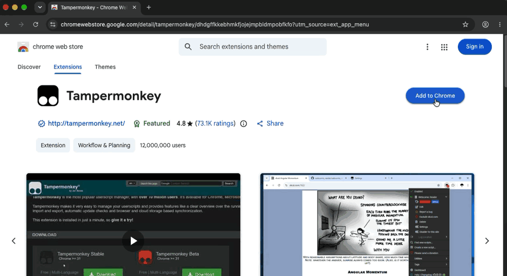
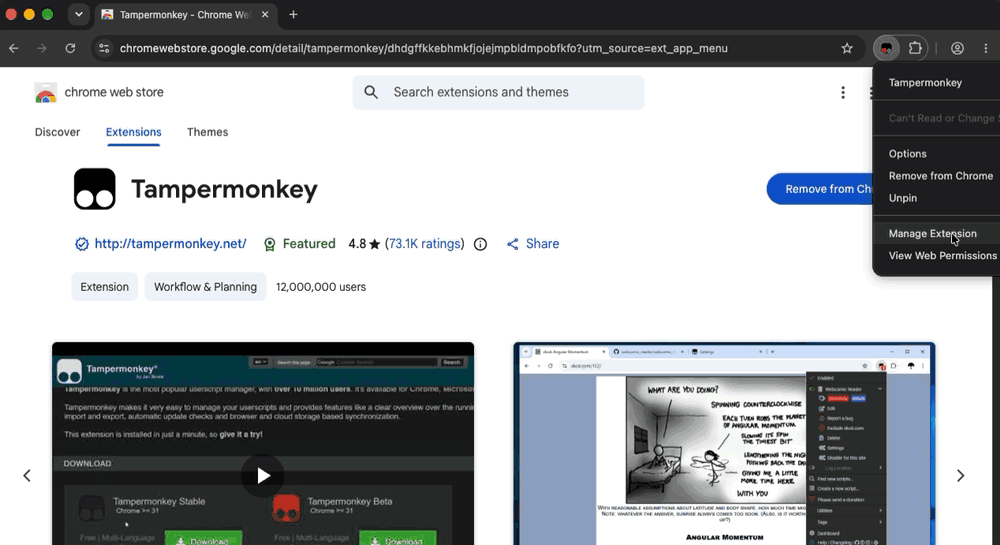
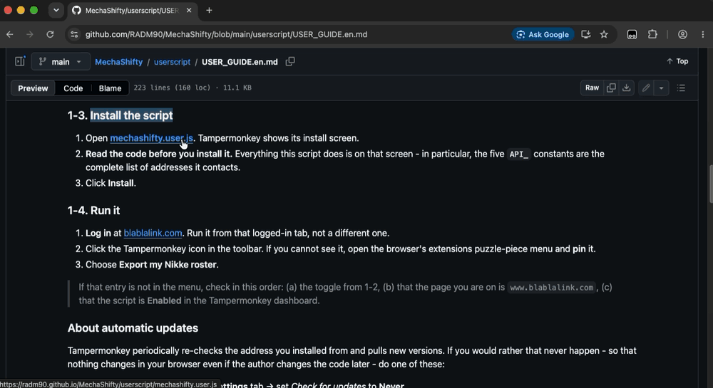
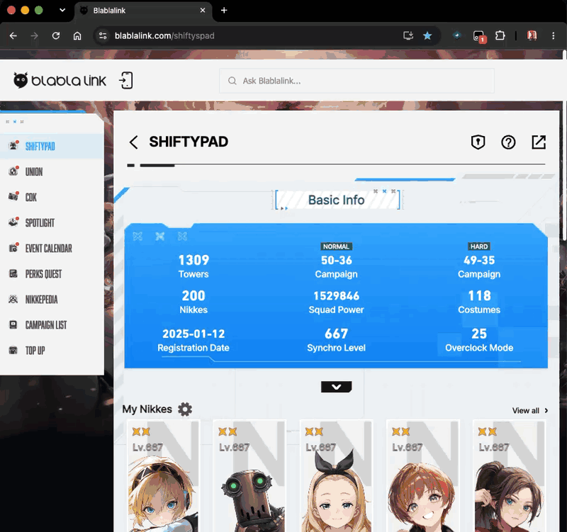

# Importing your own Nikke roster

[한국어](USER_GUIDE.md) · **English** · [日本語](USER_GUIDE.ja.md)

This is how to read **your own account's Nikke data** - the data you can already see once you log in to Blablalink (Shiftypad) - and load it into the [MechaShifty CP calculator](https://radm90.github.io/MechaShifty/#tab=calc).
Once it is in, you get the corrected combat power of every Nikke you own at a glance, and clicking any of them drops it straight into the calculator form.

This project started because the combat power Shiftypad shows disagrees with the in-game value, so **the collector script does no maths of its own.** It only carries across the values the game hands it; the combat power is computed by MechaShifty with a formula verified against real accounts (`COMBAT_POWER.md`).

The collector window speaks Korean, English and Japanese. It starts from your browser language, but **the 한국어 / English / 日本語 buttons at the top of the window switch it at any time, and the choice is remembered.** A browser's language *order* is separate from its display language - an English entry often sits above Korean or Japanese - so auto-detection can land on the wrong one, and an explicit choice always wins.

---

## Which one should I use?

|  | Tampermonkey userscript (recommended) | Bookmarklet |
|---|---|---|
| Where the code lives | Stored in your browser | Downloaded on every run |
| Install | Needs a browser extension | One bookmark |
| Running it | Pick it from the extension menu | Click the bookmark |
| If the code changes | Stays as-is until you update | Hash mismatch → **refuses to run** |
| Mobile | Difficult | Possible in some browsers |

Both do exactly the same thing and share one file, `mechashifty.user.js`.

---

## 1. Tampermonkey (recommended)

**Tampermonkey** is a browser **extension** that adds small programs (userscripts) on top of web pages.
Do the three setup steps below once, and from then on it takes **two clicks on an icon**.

These steps are for **Chrome on a PC**. Edge follows the same order with slightly different button names.
Firefox and Safari skip 1-2. On a phone, the [2. Bookmarklet](#2-bookmarklet) is easier.

| Step | What you do | When |
|---|---|---|
| 1-1 | Install Tampermonkey | Once |
| 1-2 | Turn on "Allow User Scripts" | Once |
| 1-3 | Install the MechaShifty script | Once |
| 1-4 | Run it | **Every time** |

> **Two words you will see**
> - **Extension**: a small add-on app for the browser. Tampermonkey is one.
> - **Toolbar**: the row of icons to the right of the address bar.

### 1-1. Install Tampermonkey



1. Open **[Tampermonkey on the Chrome Web Store](https://chromewebstore.google.com/detail/tampermonkey/dhdgffkkebhmkfjojejmpbldmpobfkfo)**.
   There are many look-alike extensions, so use this link.
2. Click the blue **Add to Chrome** button at the top right.
3. In the small dialog that pops up, click **Add extension**.
4. When the blue button changes to **Remove from Chrome**, it is installed.
   An icon showing **two circles inside a black square** also appears to the right of the address bar.

- **Edge**: [Tampermonkey on Edge Add-ons](https://microsoftedge.microsoft.com/addons/detail/tampermonkey/iikmkjmpaadaobahmlepeloendndfphd) → **Get** → **Add extension**.
- **Firefox, Safari, Opera**: pick your browser on [tampermonkey.net](https://www.tampermonkey.net/).

> If you cannot see the icon, click the **puzzle-piece icon** (Extensions) to the right of the
> address bar. Tampermonkey is in that list.

### 1-2. ⚠️ Turn on "Allow User Scripts" (required on Chrome and Edge)



**This is where most people get stuck.** For security, Chrome blocks userscripts by default.
Without this switch the Tampermonkey icon shows up, but **no script ever runs.**

**Chrome 138 or later, current Edge** (almost everyone)

1. **Right-click** the Tampermonkey icon on the toolbar.
2. Click **Manage Extension**. Tampermonkey's details page opens.
   If you cannot see the icon, type `chrome://extensions` (`edge://extensions` on Edge) in the address bar and click **Details** under Tampermonkey. It is the same page.
3. Scroll down a little, find the **Allow User Scripts** switch and **turn it on** (blue means on).
4. You can close that tab.

**Chrome older than 138**

1. Type `chrome://extensions` in the address bar and press Enter.
2. Turn on the **Developer mode** switch at the top right.
3. Quit the browser completely and open it again.

> To check your Chrome version, type `chrome://version` in the address bar. It is on the first line.
>
> A common trap: Tampermonkey may say "developer mode is required", but on Chrome 138 or later
> what you actually need is the **"Allow User Scripts" switch**, not developer mode.

- **Firefox and Safari**: there is no such step. On Safari, give the Tampermonkey extension **Always Allow** access to `blablalink.com` instead.

### 1-3. Install the MechaShifty script



1. Click **[mechashifty.user.js](https://radm90.github.io/MechaShifty/userscript/mechashifty.user.js)**.
2. A *Script Installation* page from tampermonkey.net shows briefly, then the install page opens in a new tab.
   The name *MechaShifty - Export my Nikke roster* is at the top.
3. Click **Install**. The tab closes and you are back where you were.
4. To check: Tampermonkey icon → **Dashboard**. MechaShifty is in the list.

> **If you get a page full of plain text (code) instead of the install page**, Tampermonkey is
> turned off or step 1-2 was skipped. Check 1-2 and click the link again.
>
> The "malicious scripts" warning on the install page is shown for every script.
> If you have a minute, skim the code below it. Everything the script does is there,
> and the five `API_` constants are the complete list of addresses it contacts.
>
> On sites other than blablalink, the icon's menu says *No script is running*. That is normal:
> this script only runs on blablalink.

### 1-4. Run it (this is all you do each time)



The Tampermonkey menu in this GIF is in Korean. The entry is in the same place in other languages.

1. **Log in** at [blablalink.com](https://www.blablalink.com/).
2. **With that logged-in tab open**, click the Tampermonkey icon on the toolbar.
3. Click **Export my Nikke roster**, right below the *MechaShifty* line in the menu.
4. The MechaShifty window appears in the middle of the page with a row of server buttons. The server linked on blablalink (or, failing that, the one you picked last time) is already selected.
5. Check that it is the server your account is on and press **Confirm** to start collecting. It takes a few seconds, depending on how many Nikkes you have.
6. When three buttons appear, it is done. Go to [3. Getting it into the calculator](#3-getting-it-into-the-calculator).

> **If that entry is not in the menu**, check these in order:
> 1. The "Allow User Scripts" switch from 1-2 is on
> 2. The current tab is on `www.blablalink.com` (the entry does not appear on other sites)
> 3. Tampermonkey icon → **Dashboard**: the MechaShifty script is **Enabled**

### About automatic updates

Tampermonkey periodically re-checks the address you installed from and pulls new versions.
If you would rather that never happen - so that nothing changes in your browser even if the author changes the code later - do one of these:

- Tampermonkey → the script → **Settings** tab → set *Check for updates* to **Never**.
- Or do not install from the URL at all: create a **new script** in the dashboard and paste the source in. With no install URL there is no update check to begin with.

---

## 2. Bookmarklet

For places where Tampermonkey is not an option (work machines, some mobile browsers).
Create a new **bookmark** and paste the whole line below into its **URL** field. Any name will do.

```
javascript:(async()=>{const U='https://radm90.github.io/MechaShifty/userscript/mechashifty.user.js',E='a63f89ae15d54339fdb1139ad18f046c96d4f84ba37c9fb077b8bb5c7487828c',l=(navigator.language||'en').toLowerCase(),M=l.startsWith('ko')?{b:'MechaShifty: 스크립트가 배포본과 다릅니다. 실행하지 않았습니다. USER_GUIDE 에서 북마클릿을 다시 복사하세요.',e:'MechaShifty: 불러오지 못했습니다 - '}:l.startsWith('ja')?{b:'MechaShifty: スクリプトが配布物と異なります。実行しませんでした。USER_GUIDE からブックマークレットをコピーし直してください。',e:'MechaShifty: 読み込めませんでした - '}:{b:'MechaShifty: the script differs from the release. Nothing was run. Copy the bookmarklet again from the USER_GUIDE.',e:'MechaShifty: could not load - '};try{const s=await(await fetch(U,{cache:'no-store'})).text();const b=await crypto.subtle.digest('SHA-256',new TextEncoder().encode(s));const g=[...new Uint8Array(b)].map(x=>x.toString(16).padStart(2,'0')).join('');if(g!==E){alert(M.b);return}(0,eval)(s)}catch(e){alert(M.e+e.message)}})();
```

Click the bookmark while you are logged in to blablalink.

All that line does is fetch the script and run it **only if its SHA-256 matches the hash baked into the line above.** If the released file differs by a single character, it refuses to run. That means the bookmark stops working whenever the script is updated and you have to copy a fresh line from here. **That is the point, not an inconvenience** - code you have not reviewed does not run.

A readable version lives in [`bookmarklet.js`](bookmarklet.js).

---

## 3. Getting it into the calculator

When collection finishes, the window offers three routes.

- **Send to the MechaShifty calculator** - opens a new tab and loads straight in.
  The hand-off names `https://radm90.github.io` as the target origin, so no other site can intercept it.
- **Save as a JSON file** - then pick it from *My account → Open JSON* in the calculator.
  This route touches the network not at all.
- **Copy to clipboard** - paste it into the *Paste* box. Convenient on mobile.

What you import stays in **this browser's localStorage only**. Nothing is sent to a server.
Press *Clear* in the calculator to delete it.

---

## What is taken, and what is not

**Taken** (all of it is already visible on your own account screens)

- Per Nikke: level · limit break / core enhancement · the three skill levels · all four gear slots with their overload options · harmony cube (kind and level) · collection item / favourite item · bond
- Account: synchro level · outpost Recycling Room research levels · account creation time · campaign progress (last cleared Normal / Hard stage) · outpost level · cleared floor of each tower (four Manufacturer Towers and the Tribe Tower)

The account values are used by the **Outpost tab** too - campaign progress fills in the outpost level and resource income, and the Manufacturer Tower card shows each tower's cleared floor next to the ceiling worked out from your account creation time.

Only values that appear on a calculator screen or feed the combat power formula are kept.
Everything else is discarded during collection, so it never reaches the file at all.

**Not taken**

- Login cookies, sessions, auth tokens - never read.
- **openid (your account identifier)** - used only as an API argument, never put in the output.
  A `scrub()` function in the script aborts the export outright if anything identifier-shaped is still present in the result.
- **Nickname and server** - the calculator does not use them, so they are not included.
- Anyone else's account - it reads only yours, and does not follow another user ID from the URL.

---

## Why it is built this way

The point is to shrink the risk of running someone else's code on top of your logged-in session.

| Property |
|---|
| Fetches and runs no external code. The bookmarklet variant is pinned by hash |
| No external libraries. JSON instead of a spreadsheet |
| Names the receiving origin explicitly; the receiver checks the sending origin in turn |
| Checks for identifiers immediately before export, so no account info can leak into the result |

There is no `eval`, `new Function`, `<script src>` or `import()` anywhere in `mechashifty.user.js`. That removes any room for code you once read to quietly start doing something else later. (Only the bookmarklet variant uses `eval`, and only on code whose hash already matched.)

---

## When it does not work

| Symptom | What to check |
|---|---|
| No entry at all in the Tampermonkey menu | **The "Allow User Scripts" toggle from 1-2.** By far the most common cause |
| It says "developer mode is required" | It may really be the "Allow User Scripts" toggle. See 1-2 |
| The script link opens a page full of plain code | Tampermonkey is off, or 1-2 was skipped. Do 1-2 and click the link again |
| Icon shows but the menu is empty | Whether the current page is `www.blablalink.com`, and whether the script is *Enabled* |
| "You are not logged in…" | Whether you are logged in to blablalink, and ran it from that tab |
| "No game account found on this server" | The server you picked, account linking and public-profile settings. A private account gets no API response |
| Nikke count or synchro level does not match your account | It read an account on another server. Run it again and pick a different server |
| "The popup was blocked" | Allow popups, or save a JSON file and import that instead |
| "No reply" | The tab that opened has to be on the **CP calculator**. Otherwise use the file route |
| Bookmarklet says it "differs from the release" | The script was updated - copy the line above again |
| The window is in the wrong language | Pick one with the language buttons at the top. It is remembered |
| A Nikke is missing from the list | Freshly released Nikkes are not in the site data yet; only those are skipped |
| Gear tier is wrong | Gear with no overload options at all reads as T9 corporation gear. Fix it in the form |

---

## Maintainer notes

Whenever `mechashifty.user.js` changes, always also:

```sh
shasum -a 256 userscript/mechashifty.user.js
```

Put the resulting hash into `EXPECT` in `bookmarklet.js` **and into the bookmarklet line in all three language guides**, then bump `@version`. Skip this and existing bookmarklet users get a refusal (which is the intended behaviour).

If the payload format (`mechashifty.roster/2`) changes, `parseRoster` in `assets/roster.js` has to change with it. Nikkes are matched by `name_code` from `data/nikkes.json`.

When you add a user-facing string, fill in all three columns (ko/en/ja) in the `STR` table in `mechashifty.user.js`.
