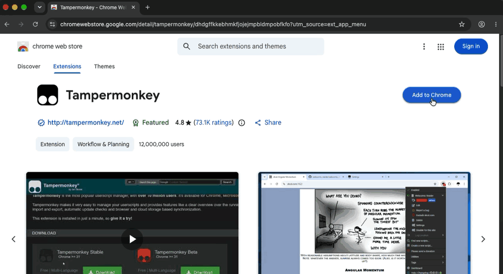
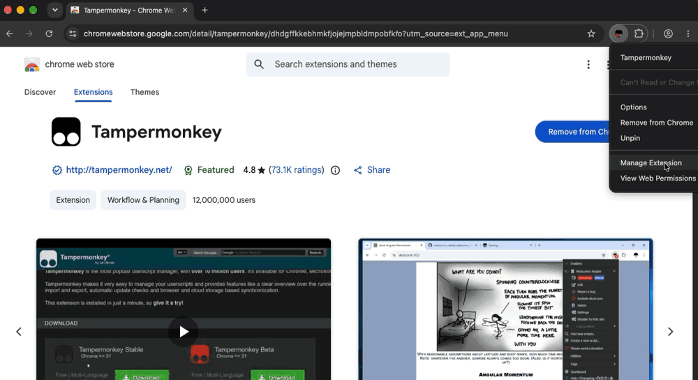
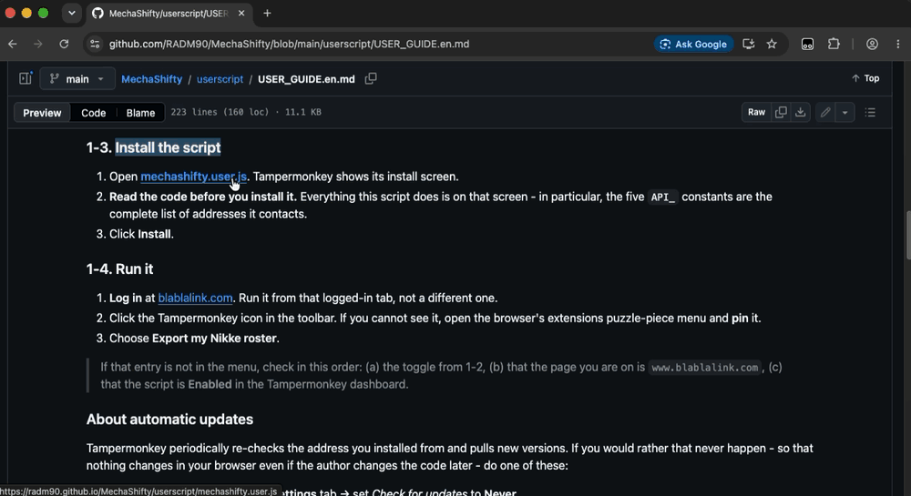
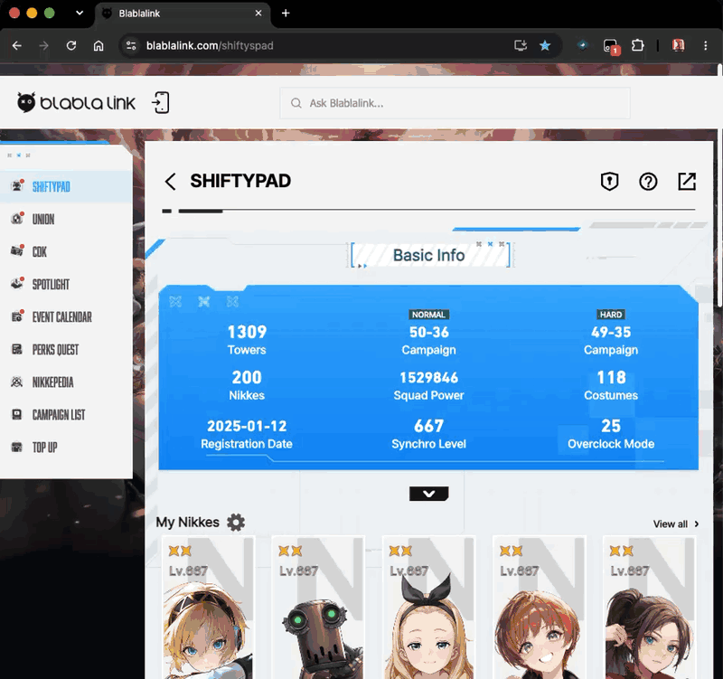

# 所持ニケデータの読み込み

[한국어](USER_GUIDE.md) · [English](USER_GUIDE.en.md) · **日本語**

Blablalink（Shiftypad）にログインすれば見られる **自分のアカウントのニケデータ** を読み取り、
[MechaShifty 戦闘力計算機](https://radm90.github.io/MechaShifty/#tab=calc) に取り込む手順です。
取り込むと所持ニケ全員の補正済み戦闘力が一覧で出て、どのニケを押してもそのまま計算機の
入力欄に載ります。

Shiftypad が表示する戦闘力とゲーム内の値がずれている--それがこのプロジェクトの出発点なので、
**収集スクリプトは計算を一切行いません。** スクリプトはゲームが返す値をそのまま運ぶだけで、
戦闘力は MechaShifty 側がワークブックで検証した式（`COMBAT_POWER.md`）で計算します。

収集ウィンドウの文言は日本語・英語・韓国語に対応しています。最初はブラウザの言語に合わせますが、
**ウィンドウ上部の 한국어 / English / 日本語 ボタンでいつでも切り替えられ、その選択は保存されます。**
ブラウザの言語の*並び順*は表示言語とは別で（日本語表示なのに一覧の先頭が英語、ということがよくあります）、
自動判定が外れることがあるため、自分で選んだ値が常に優先されます。

---

## どちらを使うか

|  | Tampermonkey ユーザースクリプト（推奨） | ブックマークレット |
|---|---|---|
| コードの置き場所 | ブラウザに保存 | 実行のたびに取得 |
| 導入 | 拡張機能が必要 | ブックマーク1つ |
| 実行 | 拡張機能メニューから選ぶ | ブックマークをクリック |
| コードが変わったら | 更新するまでそのまま | ハッシュ不一致で **実行を拒否** |
| スマホ | 難しい | ブラウザによっては可能 |

どちらも動作は同じで、`mechashifty.user.js` という1つのファイルを共有します。

---

## 1. Tampermonkey（推奨）

**Tampermonkey** は、Web ページに小さなプログラム（ユーザースクリプト）を載せるブラウザの **拡張機能** です。
最初に一度だけ下の3ステップを済ませれば、次からは **アイコンを2回クリック** するだけです。

説明は **PC 版 Chrome** が基準です。Edge も手順は同じで、ボタン名が少し違うだけです。
Firefox・Safari は 1-2 を飛ばします。スマホなら [2. ブックマークレット](#2-ブックマークレット) の方が簡単です。

| ステップ | やること | いつ |
|---|---|---|
| 1-1 | Tampermonkey を導入 | 最初の一度だけ |
| 1-2 | 「ユーザースクリプトを許可」をオン | 最初の一度だけ |
| 1-3 | MechaShifty スクリプトを導入 | 最初の一度だけ |
| 1-4 | 実行 | **使うたびに** |

> **用語を2つだけ**
> - **拡張機能**: ブラウザに機能を足す小さなアプリです。Tampermonkey もその一つです。
> - **ツールバー**: アドレスバーの右側にアイコンが並んでいる列です。
>
> 1-1〜1-3 の GIF は英語版 Chrome の画面です。ボタンの位置と順序は日本語版でも同じなので、
> かっこ内の英語名も合わせて見てください。

### 1-1. Tampermonkey を導入する



1. **[Chrome ウェブストアの Tampermonkey](https://chromewebstore.google.com/detail/tampermonkey/dhdgffkkebhmkfjojejmpbldmpobfkfo)** を開きます。
   名前の似た別の拡張機能が多いので、必ずこのリンクから入ってください。
2. 右上の青い **Chrome に追加**（Add to Chrome）ボタンを押します。
3. 小さな確認ウィンドウが出たら **拡張機能を追加**（Add extension）を押します。
4. 青いボタンが **Chrome から削除**（Remove from Chrome）に変われば導入完了です。
   アドレスバーの右に **黒い四角の中に丸が2つ** のアイコンも出ます。

- **Edge**: [Edge アドオンの Tampermonkey](https://microsoftedge.microsoft.com/addons/detail/tampermonkey/iikmkjmpaadaobahmlepeloendndfphd) で **入手** → **拡張機能の追加**。
- **Firefox・Safari・Opera**: [tampermonkey.net](https://www.tampermonkey.net/) でお使いのブラウザを選んでください。

> アイコンが見当たらないときは、アドレスバー右側の **パズルピースのアイコン**（拡張機能）を
> 押してください。その一覧の中に Tampermonkey があります。

### 1-2. ⚠️ 「ユーザースクリプトを許可」をオンにする（Chrome・Edge は必須）



**いちばんつまずきやすいステップです。** Chrome は安全のため、ユーザースクリプトの実行を既定で止めています。
これをオンにしないと Tampermonkey のアイコンは出るのに **スクリプトがまったく動きません。**

**Chrome 138 以降・最新の Edge**（ほとんどの方はこちら）

1. ツールバーの Tampermonkey アイコンを **右クリック** します。
2. メニューの **拡張機能を管理**（Manage Extension）を押します。Tampermonkey の詳細画面が開きます。
   アイコンが見当たらないときは、アドレスバーに `chrome://extensions`（Edge は `edge://extensions`）と
   入力し、Tampermonkey の **詳細**（Details）を押しても同じ画面です。
3. 少し下へスクロールし、**ユーザースクリプトを許可**（Allow User Scripts）のスイッチを **オン** にします（青くなればオン）。
4. そのタブは閉じて構いません。

**Chrome 138 未満**（古い Chrome）

1. アドレスバーに `chrome://extensions` と入力して Enter を押します。
2. 右上の **デベロッパーモード**（Developer mode）のスイッチをオンにします。
3. ブラウザを完全に終了してから、もう一度開きます。

> Chrome のバージョンは、アドレスバーに `chrome://version` と入力すると一行目に出ます。
>
> 紛らわしい点: Tampermonkey が「デベロッパーモードが必要です」と表示しても、Chrome 138 以降で
> 実際に必要なのは **デベロッパーモードではなく「ユーザースクリプトを許可」のスイッチ** です。

- **Firefox・Safari**: この手順はありません。Safari では代わりに、Tampermonkey 拡張に
  `blablalink.com` への **「常に許可」** を与えてください。

### 1-3. MechaShifty スクリプトを導入する



1. **[mechashifty.user.js](https://radm90.github.io/MechaShifty/userscript/mechashifty.user.js)** を押します。
2. tampermonkey.net の *Script Installation* ページが一瞬表示されたあと、新しいタブでインストール画面が開きます。
   上の方に *MechaShifty - 所持ニケデータの書き出し* という名前が見えます。
3. **インストール**（Install）を押します。タブが閉じて、元の画面に戻ります。
4. 確認: Tampermonkey アイコン → **ダッシュボード**（Dashboard）を押すと、一覧に MechaShifty が出ています。

> **インストール画面ではなく、文字（コード）だけが並んだページが開いたら**、Tampermonkey が
> オフになっているか、1-2 を済ませていません。1-2 を確認してから、もう一度リンクを押してください。
>
> インストール画面の「悪意のあるスクリプト」の警告は、どのスクリプトにも出る共通の文言です。
> 余裕があれば、その下のコードに目を通してください。このスクリプトがすることは全部そこにあり、
> `API_` で始まる5つの定数が接続先アドレスのすべてです。
>
> blablalink 以外のサイトでアイコンを押すと、メニューに実行中のスクリプトが無いと
> （*No script is running*）出ます。正常です。このスクリプトは blablalink でだけ動きます。

### 1-4. 実行する（毎回これだけ）



この GIF の Tampermonkey メニューは韓国語です。項目の位置は他の言語でも同じです。

1. [blablalink.com](https://www.blablalink.com/) に **ログイン** します。
2. **ログインしたそのタブを開いたまま**、ツールバーの Tampermonkey アイコンを押します。
3. メニューの *MechaShifty* の行のすぐ下にある **所持ニケデータを書き出す** を押します。
4. 画面中央に MechaShifty のウィンドウが出て、サーバーのボタンが並びます。blablalink に連携しているサーバー（無ければ前回選んだサーバー）があらかじめ選ばれています。
5. 自分のアカウントがあるサーバーか確かめて **確認** を押すと収集が始まります。ニケの数によって数秒かかります。
6. ボタンが3つ出たら完了です。[3. 計算機へ渡す](#3-計算機へ渡す) へ進んでください。

> **その項目がメニューに無いときは**、次の3つを順に確認してください。
> 1. 1-2 の「ユーザースクリプトを許可」のスイッチがオンか
> 2. 今のタブのアドレスが `www.blablalink.com` か（他のサイトのタブではメニューに出ません）
> 3. Tampermonkey アイコン → **ダッシュボード** で MechaShifty スクリプトが **有効** か

### 自動更新について

Tampermonkey は導入元のアドレスを定期的に確認し、新しい版があれば取得します。
それが嫌なら（＝作者が後からコードを変えても自分のブラウザでは絶対に変わらないようにしたいなら）、
次のどちらかを行ってください。

- Tampermonkey → 対象スクリプト → **設定** タブ →「更新の確認」を **しない** に。
- あるいは URL から導入せず、ダッシュボードで **新規スクリプト** を作ってソースを貼り付ける。
  導入元 URL が無ければ、更新確認そのものが起きません。

---

## 2. ブックマークレット

Tampermonkey が使えない環境（社用 PC、一部のスマホブラウザ）向けです。
新しい **ブックマーク（お気に入り）** を作り、**URL** 欄に下の1行をそのまま貼り付けます。名前は任意。

```
javascript:(async()=>{const U='https://radm90.github.io/MechaShifty/userscript/mechashifty.user.js',E='bfe08cfceb054a8dea802b6ed50223287c19c3cf2a562b60747c9599c43871e4',l=(navigator.language||'en').toLowerCase(),M=l.startsWith('ko')?{b:'MechaShifty: 스크립트가 배포본과 다릅니다. 실행하지 않았습니다. USER_GUIDE 에서 북마클릿을 다시 복사하세요.',e:'MechaShifty: 불러오지 못했습니다 - '}:l.startsWith('ja')?{b:'MechaShifty: スクリプトが配布物と異なります。実行しませんでした。USER_GUIDE からブックマークレットをコピーし直してください。',e:'MechaShifty: 読み込めませんでした - '}:{b:'MechaShifty: the script differs from the release. Nothing was run. Copy the bookmarklet again from the USER_GUIDE.',e:'MechaShifty: could not load - '};try{const s=await(await fetch(U,{cache:'no-store'})).text();const b=await crypto.subtle.digest('SHA-256',new TextEncoder().encode(s));const g=[...new Uint8Array(b)].map(x=>x.toString(16).padStart(2,'0')).join('');if(g!==E){alert(M.b);return}(0,eval)(s)}catch(e){alert(M.e+e.message)}})();
```

blablalink にログインした状態で、このブックマークを押すだけです。

この1行がしているのは、スクリプトを取得して **SHA-256 が上に埋め込まれた値と一致したときだけ**
実行することです。配布物が1文字でも違えば実行を拒否します。そのためスクリプトが更新されると
このブックマークは動かなくなり、ここから新しい1行を貼り直す必要があります。
**不便なのではなく、そうなるように作ってあります** - 自分が確認したコード以外は動きません。

読みやすい原本は [`bookmarklet.js`](bookmarklet.js) にあります。

---

## 3. 計算機へ渡す

収集が終わると、ウィンドウに3つの方法が出ます。

- **MechaShifty 計算機に送る** - 新しいタブが開いてそのまま入ります。
  タブ間の受け渡しは送信先 origin を `https://radm90.github.io` に固定しているので、
  他サイトが横取りすることはできません。
- **JSONファイルとして保存** - 計算機の *アカウント → JSONを開く* から選びます。
  ネットワークを一切経由しない方法です。
- **クリップボードにコピー** - *貼り付け* 欄に貼り付けます。スマホではこちらが楽です。

読み込んだデータは **このブラウザの localStorage にのみ** 残ります。サーバーには送信しません。
消すときは計算機の *消去* を押してください。

---

## 何を持ち出し、何を持ち出さないか

**持ち出すもの**（すべて自分のアカウント画面で既に見えている値です）

- ニケごと: レベル・凸／コア強化・スキル3種のレベル・装備4部位とオーバーロードOP・
  ハーモニーキューブ（種類・レベル）・コレクション／宝もの・好感度
- アカウント: シンクロレベル・前哨基地リサイクルルームの研究レベル・アカウント作成時刻・
  キャンペーン進行度（ノーマル／ハードの最終クリアステージ）・基地防御レベル・各タワーのクリア階
  （企業別タワー4種・トライブタワー）

アカウントの値は計算機だけでなく **前哨基地タブ** も使います--キャンペーン進行度から
基地防御レベルと資源の収入を埋め、企業別タワーのカードには各タワーのクリア階と、アカウント作成時刻
から求めた到達可能な最大階を並べて表示します。

計算機の画面に出るか、戦闘力の計算に入る値だけを残します。それ以外は収集の段階で捨てるので、
そもそもファイルに入りません。

**持ち出さないもの**

- ログイン Cookie・セッション・認証トークン - 読み取りません。
- **openid（アカウント識別子）** - API 呼び出しの引数としてのみ使い、成果物には入れません。
  スクリプト内の `scrub()` が、結果に識別子らしき文字列が残っていれば書き出し自体を中止します。
- **ニックネームとサーバー** - 計算機が使わないので含めません。
- 他人のアカウント - 自分のものだけを読みます。URL 上の他ユーザー ID を辿ることはしません。

---

## なぜこう作ったか

他人のコードを自分のログインセッションの上で動かす、というリスクを小さくするためです。

| 特徴 |
|---|
| 外部コードを取得して実行しない。ブックマークレット版はハッシュで固定 |
| 外部ライブラリなし。Excel ではなく JSON |
| 送信先 origin を明示。受け取る側も送信元 origin を確認する |
| 書き出す直前に識別子検査を行い、アカウント情報が結果に混ざらないようにする |

`mechashifty.user.js` の中には `eval`・`new Function`・`<script src>`・`import()` が
ありません。一度読んだコードが後から静かに別のことを始める余地を無くすためです。
（ブックマークレット版だけは `eval` を使いますが、ハッシュが一致したコードにのみ使います。）

---

## うまくいかないとき

| 症状 | 確認すること |
|---|---|
| Tampermonkey のメニューに項目が全く無い | **1-2 の「ユーザースクリプトを許可」トグル。** 最も多い原因です |
| 「デベロッパーモードが必要」と出る | 実際は「ユーザースクリプトを許可」の方かもしれません。1-2 を参照 |
| スクリプトのリンクを押すとコードだけのページが開く | Tampermonkey がオフか、1-2 が済んでいません。1-2 を済ませてリンクを押し直してください |
| アイコンは出るがメニューが空 | 今のアドレスが `www.blablalink.com` か、スクリプトが *有効* か |
| 「ログインしていないか…」 | blablalink にログインしているか、そのタブで実行したか |
| 「このサーバーではゲームアカウントが見つかりません」 | 選んだサーバー、アカウント連携と戦績の公開設定。非公開だと API が応答しません |
| ニケの数やシンクロレベルが自分のアカウントと違う | 別のサーバーのアカウントを読み取っています。もう一度実行してサーバーを選び直してください |
| 「ポップアップがブロックされました」 | ポップアップを許可するか、JSONファイルとして保存して読み込む |
| 「応答がありません」 | 開いたタブが **戦闘力計算機** タブである必要があります。駄目ならファイル経由で |
| ブックマークレットが「配布物と異なります」 | スクリプトが更新されています。上の1行を貼り直してください |
| ウィンドウの言語が違う | 上部の言語ボタンで選んでください。選択は保存されます |
| 一覧に出ないニケがいる | 実装直後のニケはサイトのデータが未収録です。そのニケだけスキップされます |
| 装備の等級が違う | オーバーロードOPが一つも無い装備は T9企業装備として扱われます。入力欄で直してください |

---

## メンテナ向けメモ

`mechashifty.user.js` を変更したら、必ず併せて行うこと:

```sh
shasum -a 256 userscript/mechashifty.user.js
```

出たハッシュを `bookmarklet.js` の `EXPECT` と **3言語すべてのガイド** のブックマークレット
1行に反映し、`@version` を上げます。忘れると既存のブックマークレット利用者は実行を拒否されます
（意図した動作です）。

payload 形式（`mechashifty.roster/2`）を変えるなら、`assets/roster.js` の `parseRoster` も
併せて修正します。ニケの照合キーは `data/nikkes.json` の `name_code` で、この値は
`tools/update_data.py --nikkes` がライブ CDN から埋めます。

画面文言を追加するときは、`mechashifty.user.js` の `STR` 表に ko/en/ja の3欄をすべて埋めます。
