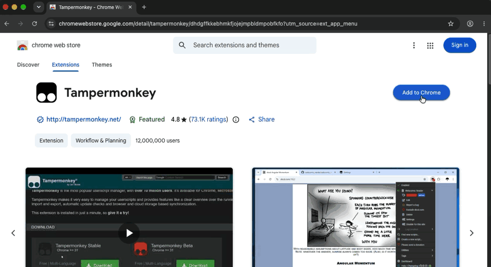
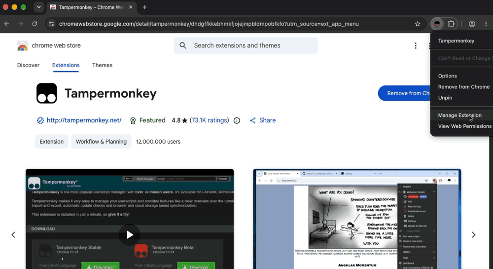
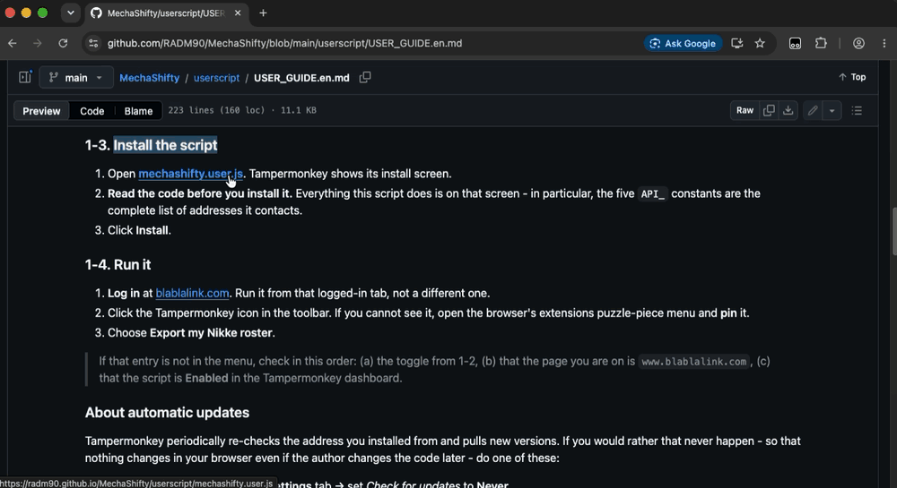
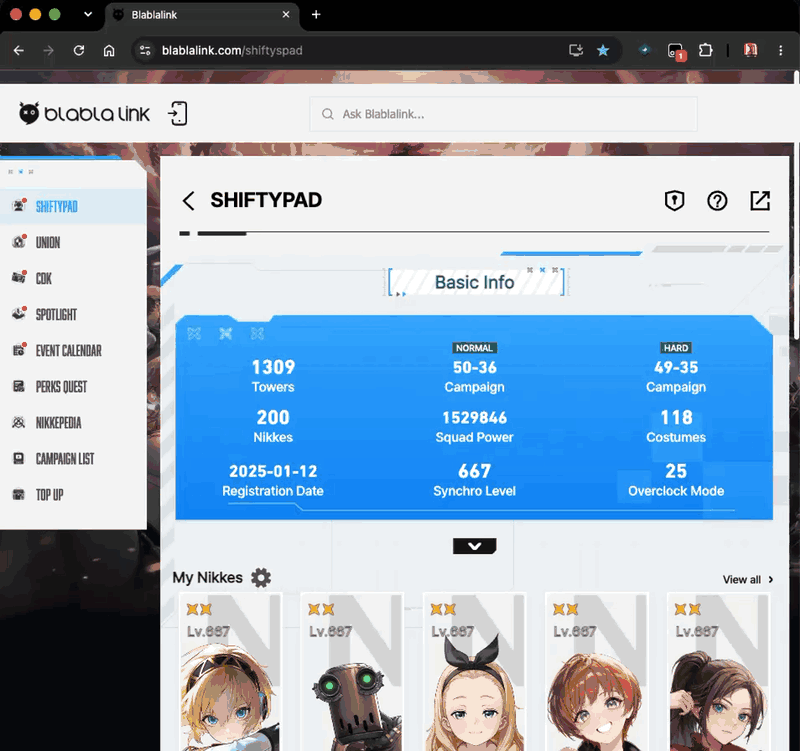

# 내 니케 데이터 가져오기

**한국어** · [English](USER_GUIDE.en.md) · [日本語](USER_GUIDE.ja.md)

Blablalink(Shiftypad)에 로그인해서 볼 수 있는 **내 계정의 니케 데이터**를 읽어,
[MechaShifty 전투력 계산기](https://radm90.github.io/MechaShifty/#tab=calc)에 넣는 방법입니다.
넣고 나면 보유 니케 전원의 보정 전투력이 한 번에 나오고, 아무 니케나 눌러 계산기 폼에
그대로 올릴 수 있습니다.

Shiftypad 가 보여주는 전투력과 인게임 값이 어긋나는 것이 이 프로젝트의 출발점이었으므로,
**계산은 수집 스크립트가 하지 않습니다.** 스크립트는 게임이 주는 값을 그대로 옮기기만 하고,
전투력은 MechaShifty 가 워크북 대조로 검증한 공식(`COMBAT_POWER.md`)으로 계산합니다.

수집 창의 문구는 한국어·영어·일본어를 지원합니다. 처음에는 브라우저 언어로 맞추지만,
**창 위쪽의 한국어 / English / 日本語 버튼으로 언제든 바꿀 수 있고 그 선택은 저장됩니다.**
브라우저의 언어 *순서* 는 화면 언어와 별개라(한글 크롬인데 목록 맨 위가 영어인 경우가 흔합니다)
자동 감지가 어긋날 수 있어서, 직접 고른 값이 항상 이깁니다.

---

## 어느 쪽을 쓸까

|  | Tampermonkey 유저스크립트 (권장) | 북마클릿 |
|---|---|---|
| 코드가 있는 곳 | 브라우저에 저장 | 실행할 때마다 내려받음 |
| 설치 | 확장 프로그램 필요 | 북마크 하나 |
| 실행 | 확장 메뉴에서 선택 | 북마크 클릭 |
| 코드가 바뀌면 | 업데이트 전까지 그대로 | 해시가 달라 **실행 거부** |
| 모바일 | 어려움 | 브라우저에 따라 가능 |

둘 다 하는 일은 같습니다. 파일 하나(`mechashifty.user.js`)를 공유합니다.

---

## 1. Tampermonkey (권장)

**Tampermonkey** 는 웹페이지에 작은 프로그램(유저스크립트)을 얹어 주는 브라우저 **확장 프로그램**입니다.
처음 한 번만 아래 세 단계를 해 두면, 다음부터는 **아이콘 클릭 두 번**으로 끝납니다.

설명은 **PC 의 Chrome** 기준입니다. Edge 도 순서는 같고 버튼 이름만 조금 다릅니다.
Firefox · Safari 는 1-2 를 건너뜁니다. 휴대폰이라면 [2. 북마클릿](#2-북마클릿)이 더 쉽습니다.

| 단계 | 할 일 | 언제 |
|---|---|---|
| 1-1 | Tampermonkey 설치 | 처음 한 번 |
| 1-2 | '사용자 스크립트 허용' 켜기 | 처음 한 번 |
| 1-3 | MechaShifty 스크립트 설치 | 처음 한 번 |
| 1-4 | 실행 | **쓸 때마다** |

> **용어 두 개만**
> - **확장 프로그램**: 브라우저에 기능을 더하는 작은 앱입니다. Tampermonkey 가 그중 하나입니다.
> - **툴바**: 주소창 오른쪽에 아이콘이 늘어선 줄입니다.
>
> 1-1 ~ 1-3 의 GIF 는 영어판 Chrome 화면입니다. 버튼 위치와 순서는 한글판도 같으니,
> 괄호 안의 영어 이름을 함께 보세요.

### 1-1. Tampermonkey 설치



1. **[Chrome 웹 스토어의 Tampermonkey](https://chromewebstore.google.com/detail/tampermonkey/dhdgffkkebhmkfjojejmpbldmpobfkfo)** 를 엽니다.
   이름이 비슷한 다른 확장이 많으니 꼭 이 링크로 들어가세요.
2. 오른쪽 위의 파란 **Chrome에 추가**(Add to Chrome) 버튼을 누릅니다.
3. 작은 확인 창이 뜨면 **확장 프로그램 추가**(Add extension) 를 누릅니다.
4. 파란 버튼이 **Chrome에서 삭제**(Remove from Chrome) 로 바뀌면 설치 끝입니다.
   주소창 오른쪽에 **검은 사각형 안에 동그라미 두 개** 가 있는 아이콘도 생깁니다.

- **Edge**: [Edge 추가 기능의 Tampermonkey](https://microsoftedge.microsoft.com/addons/detail/tampermonkey/iikmkjmpaadaobahmlepeloendndfphd) 에서 **가져오기** → **확장 추가**.
- **Firefox · Safari · Opera**: [tampermonkey.net](https://www.tampermonkey.net/) 에서 쓰는 브라우저를 고르세요.

> 아이콘이 안 보이면 주소창 오른쪽의 **퍼즐 조각 모양 아이콘**(확장 프로그램)을 누르세요.
> 그 목록 안에 Tampermonkey 가 있습니다.

### 1-2. ⚠️ '사용자 스크립트 허용' 켜기 (Chrome · Edge 필수)



**가장 많이 막히는 단계입니다.** Chrome 은 보안을 위해 유저스크립트 실행을 기본으로 막아 둡니다.
이걸 안 켜면 Tampermonkey 아이콘은 보이는데 **스크립트가 전혀 돌지 않습니다.**

**Chrome 138 이상 · 최신 Edge** (대부분 여기에 해당합니다)

1. 툴바의 Tampermonkey 아이콘을 **마우스 오른쪽 버튼**으로 누릅니다.
2. 메뉴에서 **확장 프로그램 관리**(Manage Extension) 를 누릅니다. Tampermonkey 의 세부정보 화면이 열립니다.
   아이콘이 안 보이면 주소창에 `chrome://extensions` (Edge 는 `edge://extensions`) 를 입력하고
   Tampermonkey 의 **세부정보**(Details) 를 눌러도 같은 화면입니다.
3. 아래로 조금 내려 **사용자 스크립트 허용**(Allow User Scripts) 스위치를 찾아 **켭니다**(파란색이 되면 켜진 것).
4. 그 탭은 닫아도 됩니다.

**Chrome 138 미만** (오래된 Chrome)

1. 주소창에 `chrome://extensions` 를 입력하고 Enter 를 누릅니다.
2. 오른쪽 위의 **개발자 모드**(Developer mode) 스위치를 켭니다.
3. 브라우저를 완전히 껐다가 다시 켭니다.

> 내 Chrome 버전 확인: 주소창에 `chrome://version` 을 입력하면 맨 위 줄에 나옵니다.
>
> 헷갈리는 지점: Tampermonkey 가 "개발자 모드가 필요합니다" 라고 띄워도, Chrome 138 이상에서
> 실제로 필요한 건 **개발자 모드가 아니라 '사용자 스크립트 허용' 스위치**입니다.

- **Firefox · Safari**: 이 단계가 없습니다. Safari 는 대신 Tampermonkey 확장에
  `blablalink.com` 접근 권한을 **항상 허용**으로 줘야 합니다.

### 1-3. MechaShifty 스크립트 설치



1. **[mechashifty.user.js](https://radm90.github.io/MechaShifty/userscript/mechashifty.user.js)** 를 누릅니다.
2. tampermonkey.net 의 *Script Installation* 페이지가 잠깐 보인 뒤, 새 탭에 설치 화면이 열립니다.
   위쪽에 *MechaShifty - 내 니케 데이터 내보내기* 라는 이름이 보입니다.
3. **설치**(Install) 버튼을 누릅니다. 탭이 닫히고 원래 보던 화면으로 돌아옵니다.
4. 확인: Tampermonkey 아이콘 → **대시보드**(Dashboard) 를 누르면 목록에 MechaShifty 가 보입니다.

> **설치 화면 대신 글자(코드)만 가득한 페이지가 열린다면** Tampermonkey 가 꺼져 있거나
> 1-2 를 안 한 것입니다. 1-2 를 다시 확인하고 링크를 다시 누르세요.
>
> 설치 화면의 '악성 스크립트' 경고는 어떤 스크립트에나 나오는 공통 문구입니다.
> 여유가 있다면 그 화면 아래쪽의 코드를 훑어 보세요. 이 스크립트가 하는 일 전부가 거기 있고,
> `API_` 로 시작하는 상수 다섯 개가 이 스크립트가 접속하는 주소의 전부입니다.
>
> blablalink 가 아닌 사이트에서 아이콘을 누르면 메뉴에 실행 중인 스크립트가 없다고
> (*No script is running*) 나옵니다. 정상입니다. 이 스크립트는 blablalink 에서만 돕니다.

### 1-4. 실행 (쓸 때마다 이것만)



1. [blablalink.com](https://www.blablalink.com/) 에 **로그인**합니다.
2. **로그인한 그 탭을 띄운 채로** 툴바의 Tampermonkey 아이콘을 누릅니다.
3. 메뉴의 *MechaShifty* 줄 바로 아래에 있는 **내 니케 데이터 내보내기** 를 누릅니다.
4. 화면 가운데에 MechaShifty 창이 뜨고 수집이 시작됩니다. 니케 수에 따라 몇 초 걸립니다.
5. 버튼 세 개가 나오면 끝입니다. [3. 계산기로 넘기기](#3-계산기로-넘기기)로 가세요.

> **메뉴에 그 항목이 없다면** 아래 세 가지를 순서대로 확인하세요.
> 1. 1-2 의 '사용자 스크립트 허용' 스위치가 켜져 있는지
> 2. 지금 탭 주소가 `www.blablalink.com` 인지 (다른 사이트 탭에서는 메뉴가 안 나옵니다)
> 3. Tampermonkey 아이콘 → **대시보드** 에서 MechaShifty 스크립트가 **사용** 상태인지

### 자동 업데이트에 대해

Tampermonkey 는 스크립트를 설치한 주소를 주기적으로 확인해서 새 버전이 있으면 받아 옵니다.
그게 싫다면(= 개발자가 나중에 코드를 바꿔도 내 브라우저에서는 절대 안 바뀌게 하려면)
둘 중 하나를 하세요.

- Tampermonkey → 해당 스크립트 → **설정** 탭 → *업데이트 확인*을 **사용 안 함**으로.
- 또는 URL 로 설치하지 말고, 대시보드에서 **새 스크립트**를 만들어 소스를 붙여넣기.
  설치 주소가 없으면 업데이트 확인 자체가 일어나지 않습니다.

---

## 2. 북마클릿

Tampermonkey 를 못 쓰는 환경(회사 PC, 일부 모바일 브라우저)용입니다.
새 **북마크(즐겨찾기)**를 만들고 **주소(URL)** 칸에 아래 한 줄을 통째로 붙여넣으세요. 이름은 아무거나.

```
javascript:(async()=>{const U='https://radm90.github.io/MechaShifty/userscript/mechashifty.user.js',E='3bc121136203e47d319dce6d9d2790346d1307f006c1df216d3bf971e3dce9b4',l=(navigator.language||'en').toLowerCase(),M=l.startsWith('ko')?{b:'MechaShifty: 스크립트가 배포본과 다릅니다. 실행하지 않았습니다. USER_GUIDE 에서 북마클릿을 다시 복사하세요.',e:'MechaShifty: 불러오지 못했습니다 - '}:l.startsWith('ja')?{b:'MechaShifty: スクリプトが配布物と異なります。実行しませんでした。USER_GUIDE からブックマークレットをコピーし直してください。',e:'MechaShifty: 読み込めませんでした - '}:{b:'MechaShifty: the script differs from the release. Nothing was run. Copy the bookmarklet again from the USER_GUIDE.',e:'MechaShifty: could not load - '};try{const s=await(await fetch(U,{cache:'no-store'})).text();const b=await crypto.subtle.digest('SHA-256',new TextEncoder().encode(s));const g=[...new Uint8Array(b)].map(x=>x.toString(16).padStart(2,'0')).join('');if(g!==E){alert(M.b);return}(0,eval)(s)}catch(e){alert(M.e+e.message)}})();
```

blablalink 에 로그인한 상태에서 이 북마크를 누르면 됩니다.

이 한 줄이 하는 일은 스크립트를 받아서 **SHA-256 해시가 위에 박혀 있는 값과 같을 때만**
실행하는 것입니다. 배포본이 한 글자라도 달라지면 실행을 거부합니다.
그래서 스크립트가 갱신되면 이 북마크는 동작을 멈추고, 여기서 새 줄을 다시 복사해야 합니다.
**불편한 게 아니라 그러라고 만든 것입니다** - 내가 확인한 코드가 아니면 안 돌아갑니다.

읽기 좋은 원본은 [`bookmarklet.js`](bookmarklet.js) 에 있습니다.

---

## 3. 계산기로 넘기기

수집이 끝나면 창에 세 가지 방법이 나옵니다.

- **MechaShifty 계산기로 보내기** - 새 탭이 열리고 바로 들어갑니다.
  탭 사이 전달은 받는 쪽 주소를 `https://radm90.github.io` 로 못 박아서 보내므로,
  다른 사이트가 가로챌 수 없습니다.
- **JSON 파일로 저장** - 계산기의 *내 계정 → JSON 열기* 에서 고르면 됩니다.
  네트워크를 아예 타지 않는 방법입니다.
- **클립보드로 복사** - *붙여넣기* 칸에 붙여 넣습니다. 모바일에서 편합니다.

불러온 자료는 **이 브라우저의 localStorage 에만** 남습니다. 서버로 보내지 않습니다.
지우려면 계산기의 *지우기* 를 누르세요.

---

## 무엇을 가져가고, 무엇을 안 가져가나

**가져가는 것** (전부 내 계정 화면에서 이미 보이는 값입니다)

- 니케별: 레벨 · 돌파/코어강화 · 스킬 3종 레벨 · 장비 4부위와 오버로드 옵션 ·
  하모니 큐브(종류·레벨) · 소장품/애장품 · 호감도
- 계정: 싱크로 레벨 · 전초기지 리사이클 룸 연구 레벨 · 계정 생성 시각 ·
  캠페인 진행도(노멀/하드 최종 클리어 스테이지) · 전초기지 레벨 · 타워별 클리어 층(기업 4종·트라이브)

계정 값은 계산기 말고 **전초기지 탭**도 씁니다 - 캠페인 진행도로 전초기지 레벨과 재화
수급량을 채우고, 기업 타워 카드에 타워별 클리어 층과 함께 계정 생성 시각으로 낸 도달 가능 최대 층을
보여 줍니다.

계산기 화면에 나오거나 전투력 계산에 들어가는 값만 담습니다. 그 밖의 값은 수집 단계에서
버려서 애초에 파일에 들어가지 않습니다.

**가져가지 않는 것**

- 로그인 쿠키 · 세션 · 인증 토큰 - 읽지 않습니다.
- **openid(계정 식별자)** - API 를 호출할 때 인자로만 쓰고, 결과물에는 넣지 않습니다.
  스크립트 안에 `scrub()` 함수가 있어서, 결과에 식별자 비슷한 문자열이 남아 있으면
  내보내기 자체를 중단합니다.
- **닉네임과 서버** - 계산기가 쓰지 않으므로 담지 않습니다.
- 다른 사람의 계정 - 내 계정만 읽습니다. 주소창의 다른 유저 ID 를 따라가지 않습니다.

---

## 왜 이렇게 만들었나

남의 코드를 내 로그인 세션 위에서 돌린다는 위험을 줄였습니다.

| 특징 |
|---|
| 외부 코드를 받아 실행하지 않음. 북마클릿 판은 해시로 고정 |
| 외부 라이브러리 없음. 엑셀 대신 JSON |
| 받는 쪽 origin 을 명시. 받는 쪽도 보낸 origin 을 확인 - 지정 사이트만 수신 가능 |
| 내보내기 직전에 식별자 검사를 통해 결과에 계정 정보가 섞여 나가지 않음 |

`eval`, `new Function`, `<script src>`, `import()` 가 `mechashifty.user.js` 안에 없습니다.
한 번 읽어 둔 코드가 나중에 조용히 다른 일을 하게 될 여지를 없애려는 것입니다.
(북마클릿 판만 `eval` 을 쓰는데, 그건 해시가 일치한 코드에만 씁니다.)

---

## 잘 안 될 때

| 증상 | 확인할 것 |
|---|---|
| Tampermonkey 메뉴에 항목이 아예 없음 | **1-2 의 '사용자 스크립트 허용' 토글.** 가장 흔한 원인입니다 |
| "개발자 모드가 필요합니다" 라고 뜸 | 개발자 모드가 아니라 '사용자 스크립트 허용' 쪽일 수 있습니다. 1-2 참고 |
| 스크립트 링크를 눌렀더니 코드만 가득한 페이지가 열림 | Tampermonkey 가 꺼져 있거나 1-2 를 안 한 것입니다. 1-2 를 하고 링크를 다시 누르세요 |
| 아이콘은 보이는데 메뉴가 비어 있음 | 지금 주소가 `www.blablalink.com` 인지, 스크립트가 *사용* 상태인지 |
| "로그인 상태가 아니거나…" | blablalink 에 로그인했는지, 로그인한 탭에서 실행했는지 |
| "게임 서버를 찾지 못했습니다" | 계정 연동과 전적 공개 설정. 비공개면 API 가 응답하지 않습니다 |
| "팝업이 차단됐습니다" | 팝업 허용, 또는 JSON 파일로 저장해서 불러오기 |
| "응답이 없습니다" | 열린 탭에서 **전투력 계산기** 탭이 떠 있어야 합니다. 안 되면 파일로 |
| 북마클릿이 "배포본과 다릅니다" | 스크립트가 갱신된 것입니다. 위의 한 줄을 다시 복사하세요 |
| 창이 원하는 언어가 아님 | 창 위쪽의 언어 버튼으로 고르세요. 선택은 저장됩니다 |
| 목록에 없는 니케가 있음 | 갓 출시된 니케는 사이트 데이터가 아직 모릅니다. 그 니케만 건너뜁니다 |
| 장비 등급이 틀림 | 오버로드 옵션이 하나도 없는 장비는 9티어 기업 장비로 잡힙니다. 폼에서 고치세요 |

---

## 운영자 메모

`mechashifty.user.js` 를 고치면 반드시 함께 할 것:

```sh
shasum -a 256 userscript/mechashifty.user.js
```

나온 해시를 `bookmarklet.js` 의 `EXPECT` 와 **세 언어 가이드 모두**의 북마클릿 한 줄에
반영하고, `@version` 을 올립니다. 안 하면 기존 북마클릿 사용자는 실행이 거부됩니다(의도된 동작).

payload 형식(`mechashifty.roster/2`)을 바꾸면 `assets/roster.js` 의 `parseRoster` 도
같이 고쳐야 합니다. 니케를 짝짓는 열쇠는 `data/nikkes.json` 의 `name_code` 이고,
이 값은 `tools/update_data.py --nikkes` 가 라이브 CDN 에서 채웁니다.

화면 문구를 늘릴 때는 `mechashifty.user.js` 의 `STR` 표에 ko/en/ja 세 칸을 모두 채웁니다.
